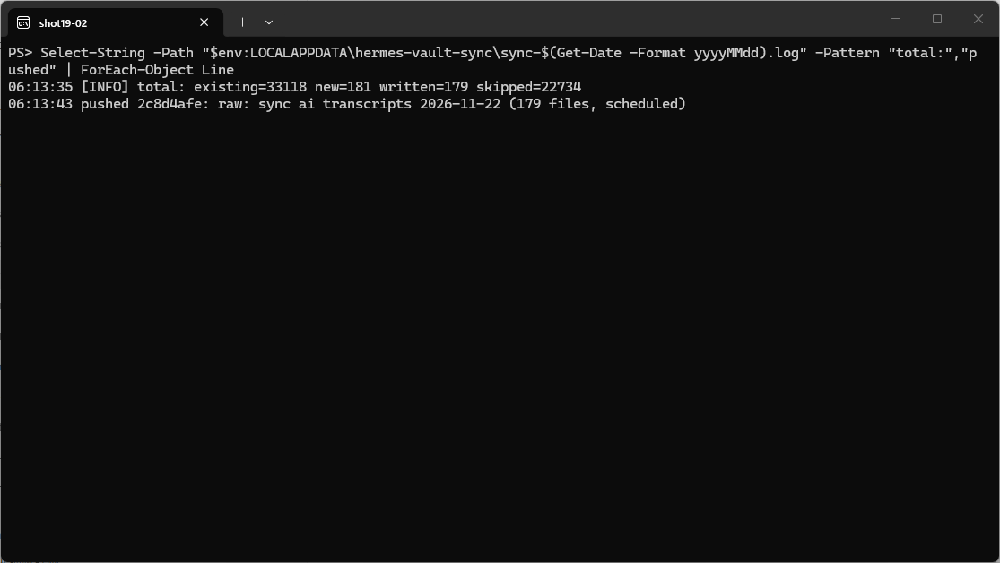
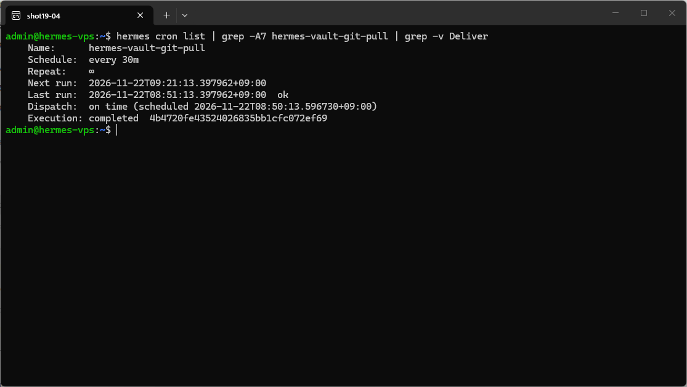
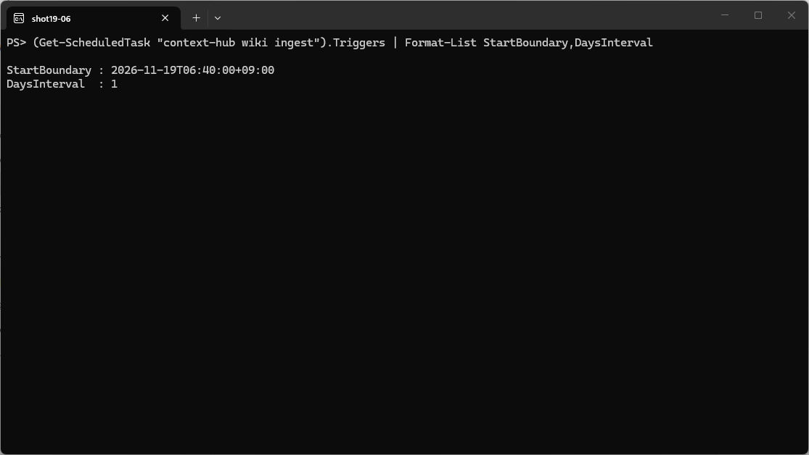
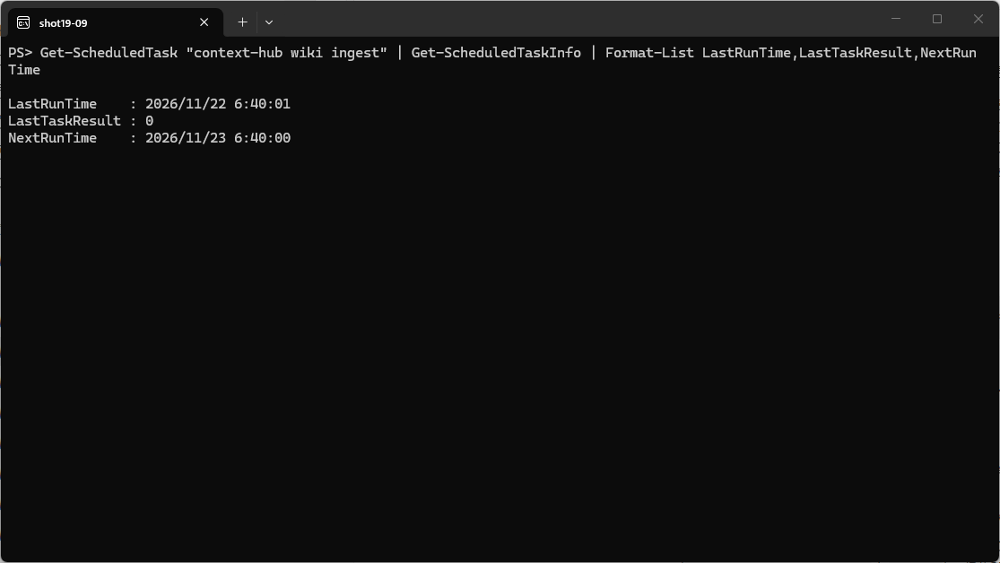
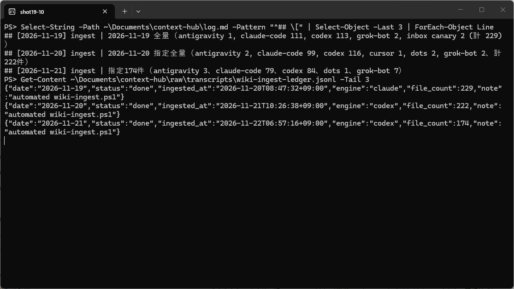
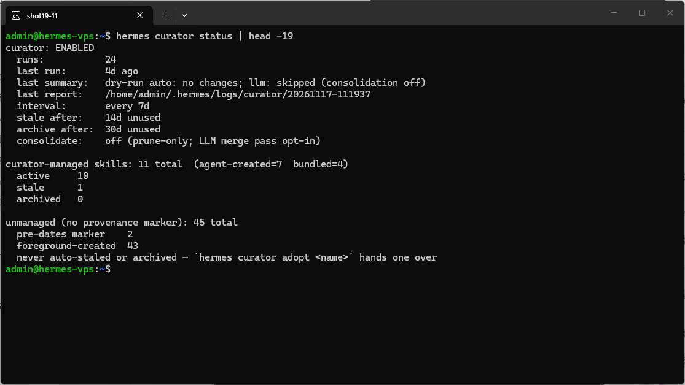
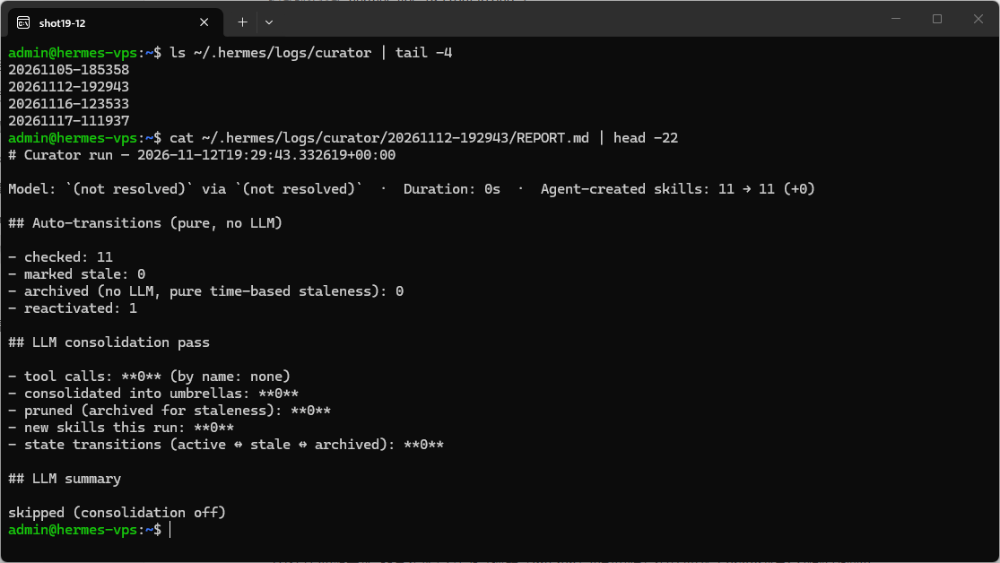
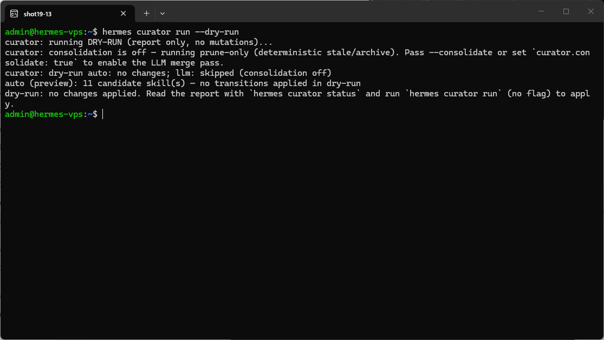
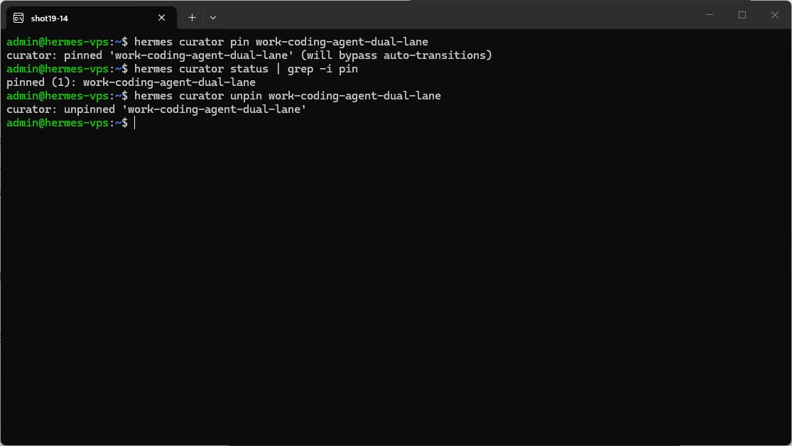

:::message
**この記事をAIに読ませる**

この記事はGitHubの公開リポジトリで管理していて、本文のMarkdownをそのまま取得できる。Claude CodeやCodexなどのAIエージェントに手順を任せたいときは、次のURLを渡すだけでいい。

https://raw.githubusercontent.com/Sora-bluesky/zenn-articles/main/articles/hermes-vps-19-auto-sync-curator.md

頼み方の例:「この記事を読んで、私の環境で手順を順番に実行して」に上のURLを添える。
:::

:::message
この連載は月1,800円ほどのVPSで、自分専用のAIエージェント(Hermes Agent)を24時間動かす実録だ。これはその第19回。全体の流れは[連載ハブ](https://zenn.dev/sora_biz/articles/hermes-vps-complete-guide)にまとめてある。
:::

:::details シリーズのもくじ(タップで開く)

**第I部VPSで24時間動かす**
- [第1回](https://zenn.dev/sora_biz/articles/hermes-vps-01-deploy) サーバー代は月1,800円で足りる。Hermes AgentはVPSで24時間動き続ける
- [第2回](https://zenn.dev/sora_biz/articles/hermes-vps-02-tailscale) パスワードはもう打つな。Hermes AgentへのSSHは鍵一発で入れる
- [第3回](https://zenn.dev/sora_biz/articles/hermes-vps-03-1password) APIキーをそのまま書くな。Hermes Agentの秘密は1Passwordが預かる
- [第4回](https://zenn.dev/sora_biz/articles/hermes-vps-04-install) Hermes AgentをDockerで隔離して動かす方法
- [第5回](https://zenn.dev/sora_biz/articles/hermes-vps-05-oauth-discord) コマンドを覚えるな。Hermes AgentはDiscordで話しかけるだけで動く
- [第6回](https://zenn.dev/sora_biz/articles/hermes-vps-06-systemd) 気づいたら止まっている、をなくせ。Hermes Agentはsystemdでいつも動き続け、落ちてもすぐ戻る

**第II部 デスクトップアプリとブラウザから操作する**
- [第7回](https://zenn.dev/sora_biz/articles/hermes-vps-07-desktop) Hermes AgentがMicrosoft Storeに来た。Windowsアプリで入れてVPSにつなぐ（旧版からの入れ替えも）
- [第8回](https://zenn.dev/sora_biz/articles/hermes-vps-08-dashboard) 手探りで動かすな。Hermes Agentはブラウザ1枚で中身が見える

**第III部 定時実行・スキル・Web検索を足す**
- [第9回](https://zenn.dev/sora_biz/articles/hermes-vps-09-cron) いつもの作業を毎回自分でやるな。Hermes Agentが決めた時刻や間隔で自動でこなす
- [第10回](https://zenn.dev/sora_biz/articles/hermes-vps-10-skills) 毎回教えるな。Hermes Agentは使えば使うほど自分で賢くなる
- [第11回](https://zenn.dev/sora_biz/articles/hermes-vps-11-web-search) 気になる情報を自分で探し回るな。Hermes Agentがネットで調べて要点だけまとめてくれる

**第IV部 記憶・話し方・スキルを管理する**
- [第12回](https://zenn.dev/sora_biz/articles/hermes-vps-12-memory) 好みを毎回言うな。Hermes AgentはMemoryで覚えている
- [第13回](https://zenn.dev/sora_biz/articles/hermes-vps-13-obsidian) メモを自分で探すな。Hermes AgentはObsidianを記憶として読む
- [第14回](https://zenn.dev/sora_biz/articles/hermes-vps-14-session-search) 毎回最初から話すな。Hermes Agentは前回の続きからそのまま動く
- [第15回](https://zenn.dev/sora_biz/articles/hermes-vps-15-import-ai-sessions) 記憶を捨てるな。Hermes AgentはClaude Codeの続きを引き継ぐ
- [第16回](https://zenn.dev/sora_biz/articles/hermes-vps-16-secondbrain) 同じことを二度調べさせるな。Hermes Agentは作業履歴からセカンドブレインを作る
- [第17回](https://zenn.dev/sora_biz/articles/hermes-vps-17-soul) 口調をブレさせるな。Hermes Agentの話し方は実は変えられる
- [第18回](https://zenn.dev/sora_biz/articles/hermes-vps-18-skill-rewrite) 使ったスキルを古いままにするな。Hermes Agentは自分でSKILL.mdを書き直す。
- **第19回**(本記事) スキルを増やしっぱなしにするな。Hermes Agentはcronで作業履歴を毎朝自動同期し、使わないスキルも片付ける。

全体像は[Hermes Agent完全構築ガイド](https://zenn.dev/sora_biz/articles/hermes-vps-complete-guide)にある。
:::

## 導入:毎朝06:10に、作業履歴の同期が人の手なしで動く

この回が終わると、第15回で手で打っていた作業履歴の同期が、毎朝自動で動く。自分のパソコン(この連載ではWindows)が06:10に書き出してpush(GitHubへ送ること)し、VPSのHermes cronが30分ごとにpull(GitHubから受け取ること)する。wikiへの取り込みは、自分のパソコンのタスクスケジューラが06:40に動かす。使わないスキルは、Curatorがstale(古くなった状態)にして、30日たつとアーカイブへ移す。

僕の環境では、同期が06:10に始まり、06:13:43にpushが終わった。件数は179件で、タスクの終了コード(成功なら0)は0だった。

第15回では、変換スクリプトの実行、git push、VPSでのgit pullを順に打ち、第16回では、wikiへの取り込みを手で頼んだ。どれも打たない日は、Hermesが読む作業履歴が古いままになる。スキルのほうは、使うたびに増える。僕のVPSでは、Curatorの管理対象が11個、管理対象外が45個あり、管理対象外のうち43個は会話の中で頼んで作ったスキルだった。

この回でやらないことが2つある。同期のスクリプト自体を作り直すこと(第15回で作ったものを、毎朝動かすだけにする)と、似たスキルをまとめさせる統合(consolidate)をオンにすることだ。

確かめたのは、Hermes v0.23.2(2026年11月22日)をVPSで動かした範囲だ。Curatorの画面だけは、2026年11月17日にv0.23.1で撮った。

## この回の到達点

作業履歴の同期が毎朝自動になり、使わないスキルはCuratorが片付ける状態にする。

第18回完了時点との差分を表にする。

| 項目 | 第18回完了時点 | 本回(第19回)完了時点 |
|---|---|---|
| 同期 | 手で打つ(第15回) | 自分のパソコンが06:10にpush、VPSのHermes cronが30分ごとにpull |
| wikiへの取り込み | 手で頼む(第16回) | 自分のパソコンのタスクスケジューラが06:40に動かす |
| 使わないスキル | 放っておく | Curatorが14日でstale、30日でアーカイブへ移す(`restore`で戻せる) |
| 次の回 | - | 第20回 |

この回で出てくる用語を先に押さえておく。

| 用語 | 意味 |
|---|---|
| タスクスケジューラ | Windowsで、決めた時刻にプログラムを動かす機能。この回では「context-hub transcript sync」(06:10)と「context-hub wiki ingest」(06:40)がこれにあたる |
| Hermes cron | 第9回の`hermes cron`。決めた間隔でエージェントを動かす。この回では`hermes-vault-git-pull`(30分ごと)がこれにあたる |
| context-hub | 僕が作業履歴とwikiを置いているリポジトリ。自分のパソコンでは`~\Documents\context-hub`にある。読者は自分のリポジトリの名前に置き換える |
| Curator | Hermesが自分で作ったスキルの状態を見て、使われないものをstaleにして、アーカイブへ移す機能 |
| stale | 14日使われなかったスキルがなる状態 |
| アーカイブ | 30日使われなかったスキルを`~/.hermes/skills/.archive/`へ移すこと。消さないので`restore`で戻せる |

## 毎朝の流れ

| 時刻 | 動くもの | やること |
|---|---|---|
| 06:10 | 自分のパソコンのタスクスケジューラ | 作業履歴を書き出して、git push |
| 06:40 | 自分のパソコンのタスクスケジューラ | wikiへの取り込み(§5) |
| 30分ごと | VPSのHermes cron | git pull(§4) |

自分のパソコン側はWindowsのタスクスケジューラ、VPS側はHermes cronが動かす。Curatorだけは時刻で動かず、Hermesのセッションが始まるときに動く(§6)。

## 自分のパソコンの同期をタスクスケジューラで毎朝動かす

第15回で手で打った変換とgit pushを1本にまとめた`sync-and-push.ps1`を、毎朝06:10に動かす。中身は、作業履歴の変換と、`git add`・`git commit`(変更を記録すること)・`git push`だ。

### タスクを登録する

スタートメニューで「タスク スケジューラ」を開き、「基本タスクの作成」からタスクを作る。名前は「context-hub transcript sync」にした。設定は次のとおりだ。

| 項目 | 設定 |
|---|---|
| トリガー | 毎日06:10 |
| 操作 | プログラムの開始 |
| プログラム/スクリプト | `powershell.exe` |
| 引数の追加 | `-NoProfile -ExecutionPolicy Bypass -File <sync-and-push.ps1の場所>` |

`-NoProfile`は設定ファイルを読まずに起動する指定、`-ExecutionPolicy Bypass`はこの1回だけスクリプトの実行制限を外す指定だ。`<sync-and-push.ps1の場所>`には、自分のパソコンに置いたスクリプトのフルパスを入れる。

僕の環境では、ウィンドウを出さないために`wscript.exe`から`.vbs`を通して起動している。表のとおり`powershell.exe`で登録すると、動くたびにウィンドウが一瞬開く。

### ログを見る

今朝も動いたかどうかの確かめ先は、ログだ。次のコマンドは、今日の日付のログから、書き出した件数の行とpushの行だけを表示する。ログのフォルダ名`hermes-vault-sync`は、前の回からの名前のままだ。

```powershell
Select-String -Path "$env:LOCALAPPDATA\hermes-vault-sync\sync-$(Get-Date -Format yyyyMMdd).log" -Pattern "total:","pushed" | ForEach-Object Line
```



`total:`の行の`written=179`が、書き出した件数だ。`pushed`の行は、pushが終わった時刻とコミットを表し、`(179 files, scheduled)`のうち`scheduled`はタスクスケジューラから動いたことを表す。

## VPSのpullをHermes cronで30分ごとに動かす

VPSでは、第9回の`hermes cron`で、30分ごとに`git pull`を1回だけ動かす。cronジョブがエージェントを動かし、ターミナルツールで次のコマンドを打たせる。

```bash
cd /root/hermes-vault && GIT_TERMINAL_PROMPT=0 git pull --ff-only
```

`GIT_TERMINAL_PROMPT=0`は、認証に失敗したときにパスワードを聞いて止まらないようにする指定だ。`--ff-only`は、追いつけるときだけ取り込む指定になる。

ターミナルツールはDockerのコンテナの中で動き、VPS本体の`~/hermes-vault`は、コンテナの中から`/root/hermes-vault`として見えるようにしてある(マウント)。VPS側のフォルダ名は前の回からの名前のままで、`~/hermes-vault`は`~/hermes-vault-repo`へのシンボリックリンク(別の場所を指す名前)になっている。

pullに使う鍵は、GitHubに読み取り専用で登録したdeploy key(1つのリポジトリだけに使える鍵。名前は`hermes-vps-readonly`)だ。秘密鍵はコンテナの中の`/root/.ssh/hermes_vault_ro`に置き、gitが使う鍵を決める設定`core.sshCommand`で、その鍵を使うようにしてある。読み取り専用なので、VPSからpushはできない。deploy keyの登録はGitHubの公式ドキュメント(Managing deploy keys)に従い、Allow write accessを付けずに登録する。

:::message alert
このジョブは、動くたびにモデルを呼ぶ。30分ごとなので、1日に48回だ。僕のVPSのデフォルトのモデルは、Codexのサブスクリプション(openai-codex)で動いている。別のモデルをデフォルトにしている場合は、呼び出しの回数の分だけ費用が増える。
:::

### VPSに入る

自分のパソコンのPowerShellから、VPSにSSHで入る。以降のコマンドは、すべてVPSの中で打つ。

```bash
ssh admin@hermes-vps
```

「Tailscale SSH requires an additional check」と出たら、表示されたURLをブラウザで開いて承認する(第2回)。

### ジョブを作る

次のコマンドは、30分ごとに動くジョブ`hermes-vault-git-pull`を作る。プロンプトには、打たせるコマンドと、成功したときの応答、失敗したときの応答、してはいけないことを書く。

```bash
hermes cron create "every 30m" --name hermes-vault-git-pull "terminal ツールで次のコマンドだけを1回実行する: cd /root/hermes-vault && GIT_TERMINAL_PROMPT=0 git pull --ff-only 。終了コード0なら最終応答は [SILENT] だけにする。失敗したら「git pull 失敗」と終了コードとエラーの要点だけを返す。修復・再試行・ファイルの編集・commit・push はしない。"
```

`[SILENT]`だけを返した回は、Hermes cronが通知を送らない(第9回)。`--deliver`を付けないと、ジョブを作った場所(Telegramなど)に結果が届く。

### ジョブを見る

登録できたかと、最後に動いた結果を見る。`grep -A7`は、一致した行とその後ろ7行を表示する指定だ。`grep -v Deliver`は、通知先の行(Telegramのチャットを見分ける番号、chat IDが出る)を外すために付ける。

```bash
hermes cron list | grep -A7 hermes-vault-git-pull | grep -v Deliver
```



`Last run`に`ok`が出ていれば、直近のpullは成功している。

## wikiへの取り込みを自分のパソコンで毎朝動かす

タスク「context-hub wiki ingest」が、毎朝06:40に`wiki-ingest.ps1`を動かす。前の日に増えた作業履歴をwikiのページに取り込み、commitしてpushするスクリプトだ。

取り込みは、まずClaude Codeの画面を開かずに1回だけ動かす`claude -p`(サブスクリプション)で行う。失敗したときだけ、Codex(`codex exec`)に切り替える。取り込んだ日は、台帳(ledger)`raw/transcripts/wiki-ingest-ledger.jsonl`に1行残る。VPS側はwikiに書かない(VPSの取り込みのcronは止めてある)。

### タスクの設定を見る

次のコマンドは、タスクの開始日時と、何日ごとに動くかを表示する。

```powershell
(Get-ScheduledTask "context-hub wiki ingest").Triggers | Format-List StartBoundary,DaysInterval
```



毎日06:40に動く設定になっている。

### 人の手なしで動いたかを見る

次のコマンドは、最後に動いた時刻と、その終了コード、次に動く時刻を表示する。

```powershell
Get-ScheduledTask "context-hub wiki ingest" | Get-ScheduledTaskInfo | Format-List LastRunTime,LastTaskResult,NextRunTime
```



`LastTaskResult`が0なら成功だ。

### ログを見る

次のコマンドは、今日のログから、どちらのエンジンが動いたかと、commit・pushの行だけを表示する。

```powershell
Select-String -Path "$env:LOCALAPPDATA\hermes-vault-sync\wiki-ingest-20261122.log" -Pattern "running claude","running codex","codex finished","committed","pushed" | ForEach-Object Line
```


この日は、Claude Codeのサインインの期限が近いという警告が出て、`claude`が終了コード1を返した。そこでCodexに切り替わり、2026年11月21日分の174件を取り込んだ。Claude Codeのサインインには期限があるので、切れる前に`claude auth login`で入り直しておく。

### wikiの記録を見る

次のコマンドは、wikiの`log.md`の見出しを最後の3つと、台帳の末尾3行を表示する。

```powershell
Select-String -Path ~\Documents\context-hub\log.md -Pattern "^## \[" | Select-Object -Last 3 | ForEach-Object Line
Get-Content ~\Documents\context-hub\raw\transcripts\wiki-ingest-ledger.jsonl -Tail 3
```



2026年11月19日分は229件(claude)、20日分は222件(codex)、21日分は174件(codex)を取り込んだ。どの日の分も、翌朝の取り込みで入っている。

### VPSの取り込みのcronを止めてある

VPSにも取り込みのcronジョブがあるが、2つとも止めてある。止め方は、`hermes cron pause <ジョブID>`だ(第9回)。

```bash
hermes cron list --all | grep -B1 -A4 -E "transcript-wiki-ingest|grok-bot-wiki-ingest"
```

![VPSでhermes cron list --allの結果を絞った画面。transcript-wiki-ingestとgrok-bot-wiki-ingestの2つが[paused]と表示されている](/images/hermes-vps/hermes-vps-19-vps-cron-paused.png)

## 使わないスキルをCuratorに片付けさせる

Curatorは、Hermesが自分で作ったスキルと、`hermes curator adopt <名前>`でCuratorの管理対象に加えたスキルを見る。14日使われないとstale、30日使われないとアーカイブへ移す。アーカイブは削除ではなく、`~/.hermes/skills/.archive/`への移動で、`hermes curator restore`で戻せる。

Curatorは、cronのように時刻では動かない。Hermesのセッションが始まるときに、前回から7日以上たっていて、2時間以上アイドル(操作がない状態)なら動く(Hermes本体の`hermes_cli/config_defaults.py`のコメント)。

Curatorが扱うのはスキルだけだ。作業履歴とwikiは対象外で、wikiの点検は第16回のlint(健全性チェック。どこからも参照されないページや、切れたリンクを探す)が受け持つ。

### 状態を見る

この節の画面は、2026年11月17日にHermes v0.23.1で撮った。次のコマンドは、状態の先頭19行を表示する。

```bash
hermes curator status | head -19
```



画面には、実行の間隔(7日おき)、stale after 14d、archive after 30d、consolidate off、管理対象と管理対象外の数が出る。僕の環境では、管理対象が11個(Hermesが自分で作ったものが7個、同梱が4個)で、active(使われている)が10個、staleが1個だった。管理対象外は45個で、14日・30日のデフォルト値は、Hermes本体の`config_defaults.py`と一致した。

### 前回の報告を読む

Curatorは、動くたびに`~/.hermes/logs/curator/`の下へ報告を残す。`run --dry-run`(次の項)も同じ場所に残るので、最新のフォルダが`--dry-run`の報告のことがある。`status`の`last run`の日付に合うフォルダを開く。

```bash
ls ~/.hermes/logs/curator | tail -4
cat ~/.hermes/logs/curator/20261112-192943/REPORT.md | head -22
```

`ls ... | tail -4`でフォルダの名前を新しい4つだけ一覧し、`cat ... | head -22`で報告の先頭22行を読む。フォルダの名前は日付と時刻で、僕の環境では`20261112-192943`が11月12日の自動実行だった。



この回の報告は、checked 11、stale 0、archived 0、reactivated 1(staleから使われる状態に戻ったスキルが1つ)だった。`LLM summary: skipped (consolidation off)`とあるとおり、統合がオフなので、LLMは使わずに終わっている。

### 何も変えずに試す

何も変えずに、Curatorが何をするかだけ見たいときは、`--dry-run`を付ける。

```bash
hermes curator run --dry-run
```



`DRY-RUN`と`no changes applied`が出て、スキルの状態は変わらない。

### 残したいスキルを固定する

片付けの対象から外したいスキルは、`pin`で固定する。`work-coding-agent-dual-lane`で、pinして、`status`で固定されたことを確かめて、`unpin`で戻した。

```bash
hermes curator pin work-coding-agent-dual-lane
hermes curator status | grep -i pin
hermes curator unpin work-coding-agent-dual-lane
```



pinしたあとの`status`には、`pinned (1): …`と出る。

Curatorの管理対象でないスキルに`pin`すると、`this skill is unmanaged`と出て、固定されない。管理対象かどうかは`hermes curator list-unmanaged`で分かる。ここに出ないスキルが管理対象だ。

## 統合(consolidate)はオンにしない

似たスキルをLLMにまとめさせる統合は、デフォルトでオフだ。1回だけ試すなら`hermes curator run --consolidate`になる。LLMの費用が出るので、この回では実行していない。

同梱スキルを片付けの対象にする設定(`prune_builtins`)も、デフォルトではオフだ。僕の`config.yaml`は`true`にしているが、この回はデフォルトのまま使う前提で書いた。

## 早見表・引用元・まとめと第20回予告

### 操作早見表

```bash
# [自分のパソコン PowerShell] 同期のログを見る
Select-String -Path "$env:LOCALAPPDATA\hermes-vault-sync\sync-$(Get-Date -Format yyyyMMdd).log" -Pattern "total:","pushed" | ForEach-Object Line

# [VPS ssh] pullのジョブを確認
hermes cron list | grep -A7 hermes-vault-git-pull | grep -v Deliver

# [自分のパソコン PowerShell] wikiへの取り込みを確認
(Get-ScheduledTask "context-hub wiki ingest").Triggers | Format-List StartBoundary,DaysInterval
Get-ScheduledTask "context-hub wiki ingest" | Get-ScheduledTaskInfo | Format-List LastRunTime,LastTaskResult,NextRunTime

# [VPS ssh] Curator
hermes curator status | head -19
ls ~/.hermes/logs/curator | tail -4
hermes curator run --dry-run
hermes curator pin <スキル名>
hermes curator unpin <スキル名>
hermes curator restore <スキル名>
```

### 引用元と参考

| 項目 | 引用元 |
|---|---|
| Curator(公式ドキュメント) | [English: Curator](https://hermes-agent.nousresearch.com/docs/user-guide/features/curator) / [日本語訳: キュレーター](https://wiki.winsmux.dev/hermes/docs/user-guide/features/curator/) |
| スキル(公式ドキュメント) | [English: Skills](https://hermes-agent.nousresearch.com/docs/user-guide/features/skills) / [日本語訳: スキル](https://wiki.winsmux.dev/hermes/docs/user-guide/features/skills/) |
| deploy key(GitHub公式ドキュメント) | [English: Managing deploy keys](https://docs.github.com/en/authentication/connecting-to-github-with-ssh/managing-deploy-keys) |
| 根拠(Hermes本体のコード) | stale 14日・アーカイブ30日・統合オフのデフォルト値と、Curatorが動く条件(前回から7日以上・2時間以上アイドル)は`hermes_cli/config_defaults.py` |
| 版の注記 | Curatorの画面はv0.23.1、それ以外はv0.23.2(2026年11月22日) |

### まとめと第20回予告

第19回完了で、作業履歴の同期が毎朝自動で動き、使わないスキルはCuratorが片付ける状態になった。内訳は次のとおり。

- 自分のパソコンのタスクスケジューラが、毎朝06:10に`sync-and-push.ps1`を動かす。僕の環境では06:13:43にpushが終わり、179件、終了コード0だった
- VPSのHermes cronが、30分ごとに`git pull --ff-only`を1回動かす。読み取り専用のdeploy keyを使い、動くたびにモデルを呼ぶ
- wikiへの取り込みは、自分のパソコンのタスクスケジューラが06:40に動かす。Claude Codeで失敗したときだけCodexに切り替わる。VPS側の取り込みのcronは止めてある
- Curatorは、Hermesが自分で作ったスキルを14日でstale、30日でアーカイブへ移す。移すだけで消さず、`restore`で戻せる。`--dry-run`は何も変えない
- 統合(`--consolidate`)はオフのまま使った

次の第20回から、第V部「Claude Code・Grok・ローカルモデルと分担する」に入る。最初は、コードの作業をデスクトップアプリから頼む話だ。連載の回数は変わる可能性がある。

---

| ← 前の回 | 次の回 → |
|---|---|
| [第18回](https://zenn.dev/sora_biz/articles/hermes-vps-18-skill-rewrite) 使ったスキルを古いままにするな。Hermes Agentは自分でSKILL.mdを書き直す。 | 第20回(近日公開) |

📑 [シリーズのもくじ](https://zenn.dev/sora_biz/articles/hermes-vps-complete-guide)

:::message
この連載はSubstack「そらのAIエージェント通信」で先行公開している。無料[登録](https://sorabiz.substack.com/subscribe)すると最新回がメールに届く。[Zennでフォロー](https://zenn.dev/sora_biz)すると新着通知が届き、全体像は[連載ハブ](https://zenn.dev/sora_biz/articles/hermes-vps-complete-guide)にまとめてある。
:::
