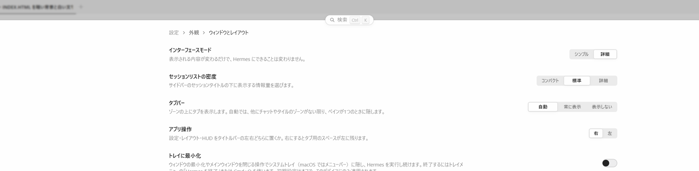
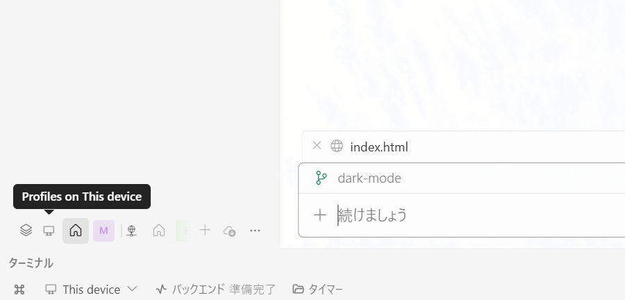
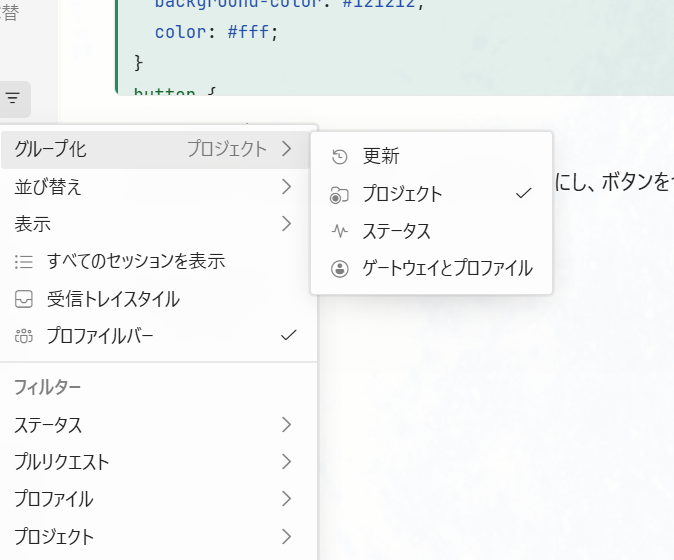
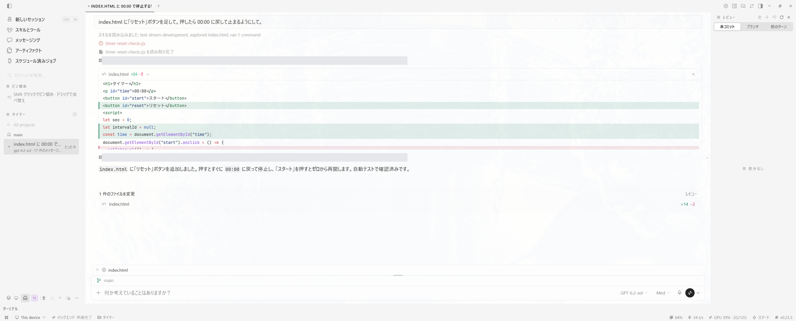

:::message
**この記事をAIに読ませる**

この記事はGitHubの公開リポジトリで管理していて、本文のMarkdownをそのまま取得できる。Claude CodeやCodexなどのAIエージェントに手順を任せたいときは、次のURLを渡すだけでいい。

https://raw.githubusercontent.com/Sora-bluesky/zenn-articles/main/articles/hermes-vps-20-desktop-vibe-coding.md

頼み方の例:「この記事を読んで、私の環境で手順を順番に実行して」に上のURLを添える。
:::

:::message
この連載は月1,800円ほどのVPSで、自分専用のAIエージェント(Hermes Agent)を24時間動かす実録だ。これはその第20回。全体の流れは[連載ハブ](https://zenn.dev/sora_biz/articles/hermes-vps-complete-guide)にまとめてある。
:::

:::details シリーズのもくじ(タップで開く)

**第I部VPSで24時間動かす**
- [第1回](https://zenn.dev/sora_biz/articles/hermes-vps-01-deploy) サーバー代は月1,800円で足りる。Hermes AgentはVPSで24時間動き続ける
- [第2回](https://zenn.dev/sora_biz/articles/hermes-vps-02-tailscale) パスワードはもう打つな。Hermes AgentへのSSHは鍵一発で入れる
- [第3回](https://zenn.dev/sora_biz/articles/hermes-vps-03-1password) APIキーをそのまま書くな。Hermes Agentの秘密は1Passwordが預かる
- [第4回](https://zenn.dev/sora_biz/articles/hermes-vps-04-install) Hermes AgentをDockerで隔離して動かす方法
- [第5回](https://zenn.dev/sora_biz/articles/hermes-vps-05-oauth-discord) コマンドを覚えるな。Hermes AgentはDiscordで話しかけるだけで動く
- [第6回](https://zenn.dev/sora_biz/articles/hermes-vps-06-systemd) 気づいたら止まっている、をなくせ。Hermes Agentはsystemdでいつも動き続け、落ちてもすぐ戻る

**第II部 デスクトップアプリとブラウザから操作する**
- [第7回](https://zenn.dev/sora_biz/articles/hermes-vps-07-desktop) Hermes AgentがMicrosoft Storeに来た。Windowsアプリで入れてVPSにつなぐ（旧版からの入れ替えも）
- [第8回](https://zenn.dev/sora_biz/articles/hermes-vps-08-dashboard) 手探りで動かすな。Hermes Agentはブラウザ1枚で中身が見える

**第III部 定時実行・スキル・Web検索を足す**
- [第9回](https://zenn.dev/sora_biz/articles/hermes-vps-09-cron) いつもの作業を毎回自分でやるな。Hermes Agentが決めた時刻や間隔で自動でこなす
- [第10回](https://zenn.dev/sora_biz/articles/hermes-vps-10-skills) 毎回教えるな。Hermes Agentは使えば使うほど自分で賢くなる
- [第11回](https://zenn.dev/sora_biz/articles/hermes-vps-11-web-search) 気になる情報を自分で探し回るな。Hermes Agentがネットで調べて要点だけまとめてくれる

**第IV部 記憶・話し方・スキルを管理する**
- [第12回](https://zenn.dev/sora_biz/articles/hermes-vps-12-memory) 好みを毎回言うな。Hermes AgentはMemoryで覚えている
- [第13回](https://zenn.dev/sora_biz/articles/hermes-vps-13-obsidian) メモを自分で探すな。Hermes AgentはObsidianを記憶として読む
- [第14回](https://zenn.dev/sora_biz/articles/hermes-vps-14-session-search) 毎回最初から話すな。Hermes Agentは前回の続きからそのまま動く
- [第15回](https://zenn.dev/sora_biz/articles/hermes-vps-15-import-ai-sessions) 記憶を捨てるな。Hermes AgentはClaude Codeの続きを引き継ぐ
- [第16回](https://zenn.dev/sora_biz/articles/hermes-vps-16-secondbrain) 同じことを二度調べさせるな。Hermes Agentは作業履歴からセカンドブレインを作る
- [第17回](https://zenn.dev/sora_biz/articles/hermes-vps-17-soul) 口調をブレさせるな。Hermes Agentの話し方は実は変えられる
- [第18回](https://zenn.dev/sora_biz/articles/hermes-vps-18-skill-rewrite) 使ったスキルを古いままにするな。Hermes Agentは自分でSKILL.mdを書き直す。
- [第19回](https://zenn.dev/sora_biz/articles/hermes-vps-19-auto-sync-curator) スキルを増やしっぱなしにするな。Hermes Agentはcronで作業履歴を毎朝自動同期し、使わないスキルも片付ける。

**第V部 Claude Code・自宅PC・ローカルモデルと分担する**
- **第20回**(本記事) バイブコーディングをターミナルでやるな。Hermes Desktopはアプリ1つで、コードレビューとGitのコミットまで済む。

全体像は[Hermes Agent完全構築ガイド](https://zenn.dev/sora_biz/articles/hermes-vps-complete-guide)にある。
:::

## 導入:バイブコーディングで、ターミナルとVS Codeを行き来していた

この回が終わると、バイブコーディング(AIに話しかけてコードを書かせるやり方)で、頼むことも、変更を確かめることも、コミットすることも、Hermes Desktopのアプリ1つで済む。

僕の環境では、練習用のタイマーのリポジトリ(プロジェクトのファイルと変更の記録を入れたフォルダ)に「リセット」ボタンを足してもらい、変更(14行増えて2行減った。画面では+14 −2)をコードレビューの画面で確かめて、コミット「リセットボタンを足す」を作るまでを、ウィンドウを切り替えずに終えた。

Claude CodeやCodexをターミナルで使うバイブコーディングでは、頼むのはターミナル、変わった所を見るのはVS Codeなどのエディタ(コードを編集するソフト)、Gitのコミットはまたターミナル、と画面を行き来することになる。Hermes Desktopなら、チャット、コードレビューの画面、ターミナルが1つのウィンドウに入っている。

この回でやらないことが2つある。VPSのHermesでコードを書かせること(VPSのプロファイルを選ぶと作業はVPSのフォルダで動くので、この回は自分のパソコンで動くほうだけを使う)と、GitHubへの送信(git push。練習用のリポジトリには送り先のGitHubのリポジトリを登録していない)だ。

確かめたのは、Hermes Desktop v0.23.3(2026年11月22日、Microsoft Store版)を、自分のパソコン(この連載ではWindows)で動かした範囲だ。モデルはgpt-6.2-sol(ChatGPT/Codexのサブスクリプション)を使った。

## この回の到達点

自分のパソコンのリポジトリをHermes Desktopのプロジェクトとして開き、チャットで直させた変更をコードレビューの画面で確かめてコミットする。worktreeで2つ目の作業を`main`と同時に開き、ターミナルも同じウィンドウで開く状態にする。

第19回完了時点との差分を表にする。

| 項目 | 第19回完了時点 | 本回(第20回)完了時点 |
|---|---|---|
| コードの作業 | 頼む(ターミナル)、変更を見る(エディタ)、コミット(ターミナル)と画面を行き来する | Hermes Desktopの1つのウィンドウで済む |
| コミット | ターミナルで`git commit`を打つ(第15回) | レビューの画面で「コミット」を押す |
| 別の作業を同時に開く | - | worktreeで`dark-mode`を作り、`main`と同時に開く |
| 次の回 | - | [第21回](https://zenn.dev/sora_biz/articles/hermes-vps-21-home-claude-code) |

この回で出てくる用語を先に押さえておく。

| 用語 | 意味 |
|---|---|
| バイブコーディング | AIに話しかけてコードを書かせるやり方。この回では、Hermesに`index.html`の修正を頼む |
| ターミナル | コマンドを打つ画面。この回では、Hermes Desktopの中でCtrl+`を押して開く |
| コードレビュー | 変更された所を確かめること。この回では、右に開く「レビュー」の画面で`index.html`の差分(+14 −2)を見る |
| Git | ファイルの変更を記録する仕組み。第15回から使っている |
| コミット | 変更をGitに記録すること。この回では「リセットボタンを足す」の1件 |
| worktree | 同じリポジトリを、別のブランチ(作業の枝分かれ)で別のフォルダに開く機能。この回では`dark-mode`を作る |
| This device | Hermes Desktopに入っているバックエンド(自分のパソコンで動くHermes)。この回ではこのdefaultプロファイルを使う |

## 練習用のリポジトリを用意する

自分の大事なリポジトリでは試さない。小さなタイマーのリポジトリを作って、練習台にする。次のPowerShellのコマンドは、`C:\hermes-demo\timer`にフォルダを作り、`index.html`と`README.md`を置いて、最初のコミットを作る。Gitは第15回から使っている前提だ。

```powershell
mkdir C:\hermes-demo\timer
cd C:\hermes-demo\timer
git init -b main
```

`git init -b main`は、このフォルダをGitのリポジトリにして、最初のブランチの名前を`main`にする指定だ。

続けて、`index.html`を作る。スタートを押すと、1秒ごとに数える20行ほどのHTMLだ。

```powershell
@'
<!doctype html>
<html lang="ja">
<head>
<meta charset="utf-8">
<title>タイマー</title>
</head>
<body>
<h1>タイマー</h1>
<p id="time">00:00</p>
<button id="start">スタート</button>
<script>
let sec = 0;
document.getElementById("start").onclick = () => {
  setInterval(() => {
    sec++;
    const m = String(Math.floor(sec / 60)).padStart(2, "0");
    const s = String(sec % 60).padStart(2, "0");
    document.getElementById("time").textContent = m + ":" + s;
  }, 1000);
};
</script>
</body>
</html>
'@ | Set-Content -Encoding utf8 index.html

"# タイマー`n`nブラウザで開くと動く、小さなタイマー。" | Set-Content -Encoding utf8 README.md
```

最後に、2つのファイルを`git add`で記録の対象にして、`git commit`でコミットする。

```powershell
git add index.html README.md
git commit -m "最初のタイマー"
```

## インターフェースモードを詳細にする

Hermes Desktopには、表示を絞る「シンプル」と、すべて出す「詳細」の2つのインターフェースモードがある。公式ドキュメント(desktop.md)では、シンプルはターミナル、ファイルブラウザ、レビューを隠す。初期値は詳細で、シンプルを自分で選んだ人だけがシンプルになる。僕の環境はシンプルになっていたので、この回の最初に詳細へ切り替えた。

設定を開き、外観、ウィンドウとレイアウトの順に進んで、「インターフェースモード」で「詳細」を選ぶ。



説明文には「表示される内容が変わるだけで、Hermes にできることは変わりません。」と出る。コードレビューの画面やターミナルが出ないときは、まずここを見る。

## This deviceのプロファイルを選ぶ

左下に並ぶプロファイルのアイコンには、This deviceのプロファイルと、第7回でつないだVPSのプロファイルが並ぶ。VPSのプロファイルを選ぶと、作業はVPSのフォルダで動く。自分のパソコンの`C:\hermes-demo\timer`を扱うこの回では、This deviceのdefaultを選ぶ。



下のバーに「This device」と「バックエンド 準備完了」が出ていれば、自分のパソコンのHermesにつながっている。

## プロジェクトを作る

### 一覧をプロジェクトごとにまとめる

セッション一覧の右上のメニューから、「グループ化」、「プロジェクト」の順に選ぶ。セッション一覧の見出しが「プロジェクト」になる。公式ドキュメント(desktop.md)によると、プロジェクトには、自分のパソコンのホームフォルダから探して見つけたリポジトリも並ぶ。



### 新規プロジェクトを作る

見出しの「＋」(マウスを重ねると「新規プロジェクト」と出る)を押す。名前に「タイマー」と入れて、「フォルダを追加」を押し、`C:\hermes-demo\timer`を選んで、「作成」を押す。

フォルダの選択では、`hermes-demo`を開いて、その中の`timer`を選ぶ。1つ上の`hermes-demo`を選ぶと、リポジトリにならない。


「アイデア」の欄(IDEA.mdに保存される)は、この回では使わず、空のままにした。

作成すると、サイドバーに「タイマー」と`main`が出る。


## チャットでバイブコーディングする

サイドバーの「タイマー」で新しいセッションを始め、次のように頼む。

```
index.html に「リセット」ボタンを足して。押したら 00:00 に戻して止まるようにして。
```

Hermesは`index.html`を書き換え、チャットの中に差分(+14 −2)と「1 件のファイルを変更」が出た。


ツールの実行の行には、自分のパソコンのフォルダの場所(パス)が出る。この画像では隠してある。

## コードレビューの画面で変更を確かめ、Gitにコミットする

Ctrl+Gを押すと、右にコードレビューの画面が開く。上のタブは「未コミット」「ブランチ」「前のターン」の3つだ。

「未コミット」には、まだコミットしていない変更が並ぶ。ここでは`index.html`(+14 −2)が出る。下のメッセージ欄に「リセットボタンを足す」と入れて、「コミット」を押す。


コミットすると、「未コミット」は「差分なし」になる。



「前のターン」のタブは、直前の依頼で変わった分を見る画面だ。読み取り専用で、ステージ(コミットの対象に加えること)、復元、コミットは「未コミット」だけでできる。


下に「Hermes にコミットと PR を任せる」もあるが、この回では使っていない。

## worktreeで別の作業を同時に開く

worktreeは、同じリポジトリを別のブランチで、別のフォルダに開く機能だ(Git公式のgit-worktree)。いまの作業に触らずに、別の変更を試せる。

Ctrl+Shift+Bを押すと、「新しいワークツリー」の画面が開く。プロジェクトは「タイマー」、ブランチ名は`dark-mode`で、「main から分岐」を選んで、「新しいワークツリー」を押す。


サイドバーの「タイマー」の下に、`main`と`dark-mode`の2つが並ぶ。`dark-mode`のセッションで、次のように頼む。

```
index.html の背景を暗い色にして、文字を白にして。
```

変わったのは`dark-mode`の側の`index.html`だけで、`main`の`index.html`は変わっていない。


worktreeは、リポジトリの中の`.worktrees/dark-mode`に作られる。`main`側で`git status`を打つと、`.worktrees/`が未追跡(Gitがまだ記録していないもの)として出る。

## ターミナルもアプリの中で開く

Ctrl+`を押すと、ウィンドウの下にターミナルが開く。選んでいるworktree(ここでは`dark-mode`)のフォルダで開き、僕の環境では`C:\hermes-demo\timer\.worktrees\dark-mode`だった。次のコマンドで、コミットの履歴と変更の状態を見る。

```powershell
git log --oneline; git status --short
```

`git log --oneline`はコミットを1行ずつ、`git status --short`は変更したファイルを短く表示する。


チャットで頼んで、レビューの画面でコミットした「リセットボタンを足す」が、履歴に並んでいる。`M index.html`は、`dark-mode`で頼んだ背景の変更で、まだコミットしていない。

## 早見表・引用元・まとめと第21回予告

### 操作早見表

| 操作 | 場所 |
|---|---|
| インターフェースモードを「詳細」にする | 設定、外観、ウィンドウとレイアウト |
| 一覧をプロジェクトごとにまとめる | セッション一覧の右上のメニュー、グループ化、プロジェクト |
| プロジェクトを作る | 見出しの「＋」(新規プロジェクト)、フォルダを追加、作成 |
| コードレビューの画面 | Ctrl+G |
| 新しいワークツリー | Ctrl+Shift+B |
| ターミナル | Ctrl+` |

### 引用元と参考

| 項目 | 引用元 |
|---|---|
| Hermes Desktop(公式ドキュメント) | [English: Hermes Desktop](https://hermes-agent.nousresearch.com/docs/user-guide/desktop) / [日本語訳: Hermes Desktop](https://wiki.winsmux.dev/hermes/docs/user-guide/desktop/) |
| git worktree(Git公式) | [English: git-worktree](https://git-scm.com/docs/git-worktree) |
| 版の注記 | Hermes Desktop v0.23.3(2026年11月22日、Microsoft Store版) |

### まとめと第21回予告

第20回完了で、Hermes Desktopのアプリ1つで、バイブコーディング、コードレビュー、Gitのコミットまで済む状態になった。内訳は次のとおり。

- インターフェースモードを「詳細」にして、コードレビューの画面とターミナルを出した
- This deviceのdefaultプロファイルで、自分のパソコンの`C:\hermes-demo\timer`をプロジェクト「タイマー」として開いた
- チャットで「リセット」ボタンを頼み、Ctrl+Gのレビューの画面で`index.html`(+14 −2)を確かめて、「リセットボタンを足す」をコミットした
- Ctrl+Shift+Bで`dark-mode`のworktreeを作り、`main`と同時に開いて作業した
- Ctrl+`でアプリの中にターミナルを開き、`git log --oneline`でコミットを確かめた

次の第21回は、VPSのHermesから、自宅のパソコンのClaude Codeに作業を頼む話だ。連載の回数は変わる可能性がある。

---

| ← 前の回 | 次の回 → |
|---|---|
| [第19回](https://zenn.dev/sora_biz/articles/hermes-vps-19-auto-sync-curator) スキルを増やしっぱなしにするな。Hermes Agentはcronで作業履歴を毎朝自動同期し、使わないスキルも片付ける。 | [第21回 PCの前に行くな。スマホからHermes Agentに頼めば、自宅のClaude Codeが答える。](https://zenn.dev/sora_biz/articles/hermes-vps-21-home-claude-code) |

📑 [シリーズのもくじ](https://zenn.dev/sora_biz/articles/hermes-vps-complete-guide)

:::message
この連載はSubstack「そらのAIエージェント通信」で先行公開している。無料[登録](https://sorabiz.substack.com/subscribe)すると最新回がメールに届く。[Zennでフォロー](https://zenn.dev/sora_biz)すると新着通知が届き、全体像は[連載ハブ](https://zenn.dev/sora_biz/articles/hermes-vps-complete-guide)にまとめてある。
:::
