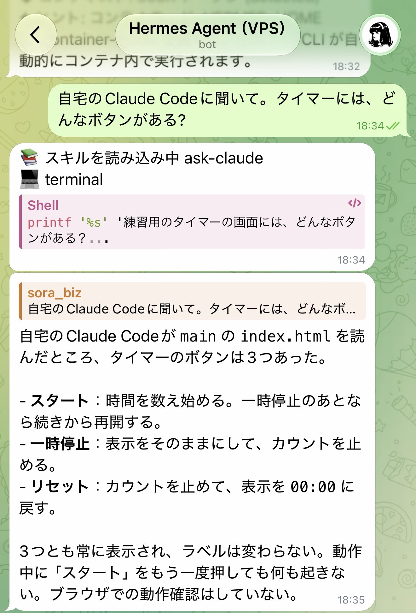
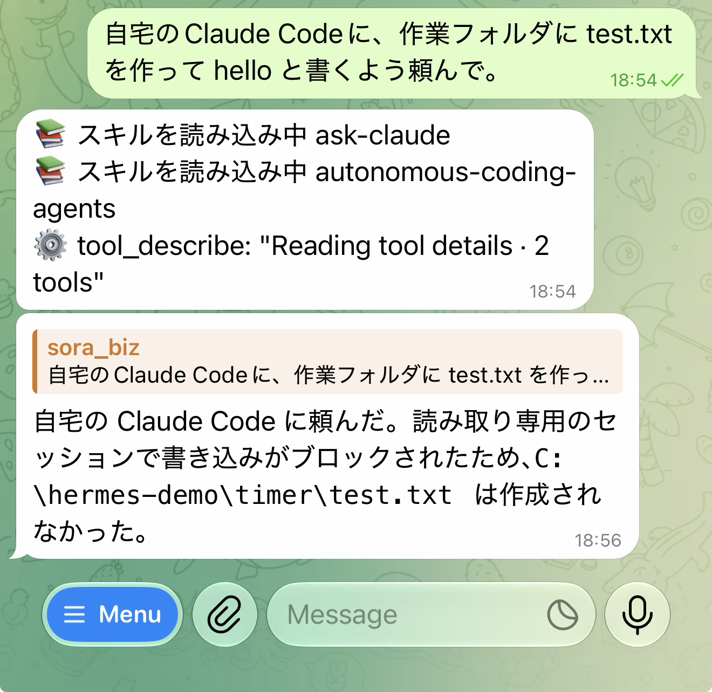

:::message
**この記事をAIに読ませる**

この記事はGitHubの公開リポジトリで管理していて、本文のMarkdownをそのまま取得できる。Claude CodeやCodexなどのAIエージェントに手順を任せたいときは、次のURLを渡すだけでいい。

https://raw.githubusercontent.com/Sora-bluesky/zenn-articles/main/articles/hermes-vps-21-home-claude-code.md

頼み方の例:「この記事を読んで、私の環境で手順を順番に実行して」に上のURLを添える。
:::

:::message
この連載は月1,800円ほどのVPSで、自分専用のAIエージェント(Hermes Agent)を24時間動かす実録だ。これはその第21回。全体の流れは[連載ハブ](https://zenn.dev/sora_biz/articles/hermes-vps-complete-guide)にまとめてある。
:::

:::details シリーズのもくじ(タップで開く)

**第I部VPSで24時間動かす**
- [第1回](https://zenn.dev/sora_biz/articles/hermes-vps-01-deploy) サーバー代は月1,800円で足りる。Hermes AgentはVPSで24時間動き続ける
- [第2回](https://zenn.dev/sora_biz/articles/hermes-vps-02-tailscale) パスワードはもう打つな。Hermes AgentへのSSHは鍵一発で入れる
- [第3回](https://zenn.dev/sora_biz/articles/hermes-vps-03-1password) APIキーをそのまま書くな。Hermes Agentの秘密は1Passwordが預かる
- [第4回](https://zenn.dev/sora_biz/articles/hermes-vps-04-install) Hermes AgentをDockerで隔離して動かす方法
- [第5回](https://zenn.dev/sora_biz/articles/hermes-vps-05-oauth-discord) コマンドを覚えるな。Hermes AgentはDiscordで話しかけるだけで動く
- [第6回](https://zenn.dev/sora_biz/articles/hermes-vps-06-systemd) 気づいたら止まっている、をなくせ。Hermes Agentはsystemdでいつも動き続け、落ちてもすぐ戻る

**第II部 デスクトップアプリとブラウザから操作する**
- [第7回](https://zenn.dev/sora_biz/articles/hermes-vps-07-desktop) Hermes AgentがMicrosoft Storeに来た。Windowsアプリで入れてVPSにつなぐ（旧版からの入れ替えも）
- [第8回](https://zenn.dev/sora_biz/articles/hermes-vps-08-dashboard) 手探りで動かすな。Hermes Agentはブラウザ1枚で中身が見える

**第III部 定時実行・スキル・Web検索を足す**
- [第9回](https://zenn.dev/sora_biz/articles/hermes-vps-09-cron) いつもの作業を毎回自分でやるな。Hermes Agentが決めた時刻や間隔で自動でこなす
- [第10回](https://zenn.dev/sora_biz/articles/hermes-vps-10-skills) 毎回教えるな。Hermes Agentは使えば使うほど自分で賢くなる
- [第11回](https://zenn.dev/sora_biz/articles/hermes-vps-11-web-search) 気になる情報を自分で探し回るな。Hermes Agentがネットで調べて要点だけまとめてくれる

**第IV部 記憶・話し方・スキルを管理する**
- [第12回](https://zenn.dev/sora_biz/articles/hermes-vps-12-memory) 好みを毎回言うな。Hermes AgentはMemoryで覚えている
- [第13回](https://zenn.dev/sora_biz/articles/hermes-vps-13-obsidian) メモを自分で探すな。Hermes AgentはObsidianを記憶として読む
- [第14回](https://zenn.dev/sora_biz/articles/hermes-vps-14-session-search) 毎回最初から話すな。Hermes Agentは前回の続きからそのまま動く
- [第15回](https://zenn.dev/sora_biz/articles/hermes-vps-15-import-ai-sessions) 記憶を捨てるな。Hermes AgentはClaude Codeの続きを引き継ぐ
- [第16回](https://zenn.dev/sora_biz/articles/hermes-vps-16-secondbrain) 同じことを二度調べさせるな。Hermes Agentは作業履歴からセカンドブレインを作る
- [第17回](https://zenn.dev/sora_biz/articles/hermes-vps-17-soul) 口調をブレさせるな。Hermes Agentの話し方は実は変えられる
- [第18回](https://zenn.dev/sora_biz/articles/hermes-vps-18-skill-rewrite) 使ったスキルを古いままにするな。Hermes Agentは自分でSKILL.mdを書き直す。
- [第19回](https://zenn.dev/sora_biz/articles/hermes-vps-19-auto-sync-curator) スキルを増やしっぱなしにするな。Hermes Agentはcronで作業履歴を毎朝自動同期し、使わないスキルも片付ける。

**第V部 Claude Code・自宅PC・ローカルモデルと分担する**
- [第20回](https://zenn.dev/sora_biz/articles/hermes-vps-20-desktop-vibe-coding) バイブコーディングをターミナルでやるな。Hermes Desktopはアプリ1つで、コードレビューとGitのコミットまで済む。
- **第21回**(本記事) PCの前に行くな。スマホからHermes Agentに頼めば、自宅のClaude Codeが答える。

全体像は[Hermes Agent完全構築ガイド](https://zenn.dev/sora_biz/articles/hermes-vps-complete-guide)にある。
:::

## 導入 外出先で、自宅のClaude Codeに聞きたい

この回が終わると、スマホのTelegramでHermesに頼むだけで、自宅のパソコンにあるClaude Codeが、リポジトリのファイルを読んで答えてくれる。

僕の環境では、第20回の練習用のタイマーのリポジトリについて、Telegramから「自宅のClaude Codeに聞いて。タイマーには、どんなボタンがある?」と送った。返ってきたのは、スタート・一時停止・リセットの3つと、`index.html`を読んだという説明だった。書き込みを頼んだときは、自宅のClaude Codeは書き込めず、ファイルは作られなかった。

外出先で「あのリポジトリ、どうなってたっけ」と思っても、自分のパソコンの前に戻らなければ、Claude Codeには聞けない。この回で、その聞く手間をなくす。

この回でやらないことが2つある。1つは、自宅のClaude Codeにファイルを書かせたり、コマンドを実行させたりすること。質問に答えるだけにして、書き込みの許可は出さない。もう1つは、自宅のWindowsにOpenSSHサーバーを入れる手順の書き起こしだ。手順はMicrosoftの公式ページを見てほしい。

確かめたのは、Hermes v0.23.3(2026年11月24日)をVPSで動かし、自宅のパソコン(Windows)のClaude Codeにつないだ範囲だ。

## この回の到達点

スマホのTelegramでHermesに頼むと、VPSのHermesがTailscale越しに自宅のパソコンへSSHでつなぎ、自宅のClaude Codeが読み取り専用で答え、その答えがTelegramに返る状態にする。

- スマホのTelegramで、Hermesに質問を頼む
- VPSのHermesが、Tailscale越しに自宅のパソコンへSSHでつなぐ
- 自宅のClaude Codeが、ファイルを読むだけで答える
- 答えがTelegramに返る

前提は次の4つだ。

- 第2回のTailscaleが、VPSと自宅のパソコンの両方に入っている
- 自宅のWindowsでOpenSSHサーバーが動いている。入れ方は[Microsoftの公式ページ](https://learn.microsoft.com/ja-jp/windows-server/administration/openssh/openssh_install_firstuse)にある
- Claude Codeに、自宅のパソコンでログイン済みである
- 第20回で作った練習用のタイマーのリポジトリ`C:\hermes-demo\timer`がある

| 用語 | 意味 |
|---|---|
| Claude Code | AnthropicのAIエージェント。この回では自宅のパソコンで`claude`コマンドとして動く |
| SSH | 別のパソコンに安全につないでコマンドを送る仕組み。この回ではVPSから自宅のパソコンへつなぐ |
| Tailscale | 自分の機器だけをつなぐ専用のネットワーク。第2回で入れた |
| スキル | Hermesに覚えさせる手順書。この回では`~/.hermes/skills/ask-claude/`に置く |
| 公開鍵・秘密鍵 | SSHの鍵のペア。秘密鍵はVPSに置き、公開鍵を自宅のパソコンに登録する |

## 公式のRemote Controlとの違い

Claude Codeには、公式の[Remote Control](https://code.claude.com/docs/en/remote-control)という機能がある。公式ページを2026年11月24日に確認した範囲で書く。

- 自分のパソコンで動いているClaude Codeのセッションに、claude.ai/codeやClaudeアプリからつなぐ機能だ
- 起動は`claude remote-control`(または`claude --remote-control`。セッション中なら`/remote-control`)
- セッションは自分のパソコンで動き、ローカルのファイルを触る。パソコンは起動したままにして、`claude`コマンドも実行したままにしておく必要がある
- 通信は自分のパソコンからの外向きのHTTPSだけで、外からつなぐための受け付け口(ポート)は開かない
- Pro・Max・Ultra・Team・Enterpriseのプランで使える(TeamとEnterpriseは管理者が有効にする)。APIキーは使えない

この回のやり方との違いは3つある。

- ふだんのTelegramでHermesに話しかけるだけで済む
- 自宅のパソコン側で、使えるツールを、ファイルを探す・読むための3つに絞っていて、質問に答えるだけにしている
- そのかわり、SSHの受け付けと鍵の設定が要る

どちらも、自宅のパソコンは起動しておく必要がある。Remote Controlはセッションそのものを操作する機能で、この回は質問を1回送って、答えを1回受け取るだけだ。

## 自宅のパソコンに、読み取り専用のスクリプトを置く

自宅のパソコンに、質問を受け取ってClaude Codeに渡し、答えを返すスクリプトを置く。置き場所は`%USERPROFILE%\bin\ask-claude\`にする。動かすファイルは3つで、動作を確かめるテストを1つ足す。

- `ask-claude.cmd` SSHから最初に呼ばれるファイル
- `ask-claude.ps1` 質問を検査して、Claude Codeを起動する本体
- `ask-claude-settings.json` Claude Codeに渡す、読んではいけない場所の設定
- `test-ask-claude.ps1` 入力の検査と渡す引数を確かめるテスト

### 最初に呼ばれるask-claude.cmd

SSHから呼ばれて、同じフォルダの`ask-claude.ps1`を起動するだけだ。

```bat
@echo off
pwsh -NoProfile -NonInteractive -ExecutionPolicy Bypass -File "%~dp0ask-claude.ps1"
```

### 設定のask-claude-settings.json

Claude Codeの`--settings`に渡す。`.ssh`や`.env`など、読ませたくない場所の読み込みを拒否し、書き込みやコマンド実行のツールも拒否する。

```json
{
  "permissions": {
    "deny": [
      "Read(~/.ssh/**)",
      "Read(~/.claude/**)",
      "Read(~/.claude.json)",
      "Read(~/.codex/**)",
      "Read(~/.hermes/**)",
      "Read(~/AppData/**)",
      "Read(//c/ProgramData/ssh/**)",
      "Read(**/.env)",
      "Read(**/.env.*)",
      "Bash",
      "PowerShell",
      "Edit",
      "Write",
      "NotebookEdit",
      "WebFetch",
      "WebSearch"
    ]
  }
}
```

### 本体のask-claude.ps1

本体は長いので、制限の要点を表にした。全文はこの表の下に折りたたんである。

| 制限 | 中身 |
|---|---|
| 1回で終わる | claudeは`-p`(1回答えて終わる)で起動する |
| ツールを3つに絞る | `--restricted`と`--tools Read,Glob,Grep`を付け、使えるツールをファイルを探す・読むの3つだけにする。`--restricted`を付けると、自宅の設定ファイルを読まず、作業フォルダの外のファイルも読めなくなる(公式の`claude --help`の説明) |
| 念のため外す | `--disallowedTools`で、Bash・PowerShell・Edit・Write・NotebookEdit・WebFetch・WebSearchも外す。`--settings`で、`.ssh`や`.env`を読む許可を拒否する |
| 作業フォルダを固定する | 作業フォルダは`C:\hermes-demo\timer`に固定してある |
| 質問は標準入力だけ | 質問は標準入力(スクリプトに流し込まれる文字)から4000字まで受け取る。SSHで送られたコマンドの文字列(`SSH_ORIGINAL_COMMAND`)は使わず、環境変数(プログラムに設定を渡す変数)からも消す |
| タイムアウト | 質問の読み込みと答えの待ちを合わせて300秒で打ち切る |

:::details ask-claude.ps1の全文(タップで開く)

```powershell
param([switch]$DryRun)

$workFolder = "C:\hermes-demo\timer"
$settings = Join-Path $PSScriptRoot 'ask-claude-settings.json'
$utf8 = [Text.UTF8Encoding]::new($false)
[Console]::InputEncoding = [Console]::OutputEncoding = $utf8

function Get-TimeLeft { [int][Math]::Max(0, 300000 - $timer.ElapsedMilliseconds) }
function Wait-Pipe([Threading.Tasks.Task]$task) {
    $remaining = Get-TimeLeft
    if ($remaining -eq 0 -or !([IAsyncResult]$task).AsyncWaitHandle.WaitOne($remaining)) {
        throw [TimeoutException]::new()
    }
    $task.GetAwaiter().GetResult()
}

$timer = [Diagnostics.Stopwatch]::StartNew()
$inputStream = [Console]::OpenStandardInput()
$decoder = $utf8.GetDecoder()
$bytes = [byte[]]::new(1024)
$chars = [char[]]::new($utf8.GetMaxCharCount($bytes.Length))
$questionText = [Text.StringBuilder]::new()
$firstChunk = $true
$characterCount = 0
try {
    do {
        $size = Wait-Pipe ($inputStream.ReadAsync($bytes, 0, $bytes.Length))
        $decoded = $decoder.GetChars($bytes, 0, $size, $chars, 0, ($size -eq 0))
        if ($decoded -eq 0) { continue }
        $chunk = [string]::new($chars, 0, $decoded)
        if ($firstChunk -and $chunk[0] -eq [char]0xFEFF) { $chunk = $chunk.Substring(1) }
        $firstChunk = $false
        $characterCount += @($chunk.EnumerateRunes()).Count
        if ($characterCount -gt 4000) {
            [Console]::Error.WriteLine('The question must be 4000 characters or fewer.')
            exit 2
        }
        [void]$questionText.Append($chunk)
    } while ($size -gt 0)
} catch [TimeoutException] {
    [Console]::Error.WriteLine('Timed out after 300 seconds while reading stdin.')
    exit 124
}
$question = $questionText.ToString()

if ([string]::IsNullOrWhiteSpace($question)) {
    [Console]::Error.WriteLine('Enter a question on stdin.')
    exit 2
}
if (!(Test-Path -LiteralPath $workFolder -PathType Container)) {
    [Console]::Error.WriteLine('The Claude work folder does not exist.')
    exit 3
}
$claude = Get-Command claude -CommandType Application -All -ErrorAction SilentlyContinue |
    Where-Object Name -EQ 'claude.exe' | Select-Object -First 1 -ExpandProperty Source
if (!$claude) { $claude = "$env:USERPROFILE\.local\bin\claude.exe" }
if (!(Test-Path -LiteralPath $claude -PathType Leaf)) {
    [Console]::Error.WriteLine('claude.exe was not found.')
    exit 3
}
if (!(Test-Path -LiteralPath $settings -PathType Leaf)) {
    [Console]::Error.WriteLine('ask-claude-settings.json was not found.')
    exit 3
}

$arguments = @('-p', '--output-format', 'text', '--permission-mode', 'default', '--strict-mcp-config', '--restricted', '--tools', 'Read,Glob,Grep',
    '--disallowedTools', 'Bash', 'PowerShell', 'Edit', 'Write', 'NotebookEdit', 'WebFetch', 'WebSearch',
    '--settings', $settings)
if ($DryRun) {
    $claude
    $workFolder
    $arguments
    exit 0
}

$start = [Diagnostics.ProcessStartInfo]::new($claude)
$start.WorkingDirectory = $workFolder
$start.UseShellExecute = $false
$start.RedirectStandardInput = $start.RedirectStandardOutput = $start.RedirectStandardError = $true
$start.StandardInputEncoding = $start.StandardOutputEncoding = $start.StandardErrorEncoding = $utf8
[void]$start.Environment.Remove('SSH_ORIGINAL_COMMAND')
foreach ($argument in $arguments) { $start.ArgumentList.Add($argument) }

$child = $null
try {
    if ((Get-TimeLeft) -eq 0) { throw [TimeoutException]::new() }
    $child = [Diagnostics.Process]::Start($start)
    # Drain both output pipes while sending the question.
    $stdout = $child.StandardOutput.ReadToEndAsync()
    $stderr = $child.StandardError.ReadToEndAsync()
    try {
        $null = Wait-Pipe ($child.StandardInput.WriteAsync($question))
        $child.StandardInput.Close()
    } catch [IO.IOException] {
        # Claude can close stdin early. Keep its exit code.
    }
    if (!$child.WaitForExit((Get-TimeLeft))) { throw [TimeoutException]::new() }
    $answer = Wait-Pipe $stdout
    [Console]::Error.Write((Wait-Pipe $stderr))
    [Console]::Write($answer)
    exit $child.ExitCode
} catch [TimeoutException] {
    if ($child) { try { $child.Kill($true) } catch [InvalidOperationException] {} }
    [Console]::Error.WriteLine('Claude timed out after 300 seconds.')
    exit 124
} finally { if ($child) { $child.Dispose() } }
```

:::

### 禁止するツールではなく、使ってよいツールを並べる

Claude Codeには、ファイルを書くツールのほかに、PowerShellのツールや、書き込めるサブエージェント(Claude Codeが呼び出す別の担当)もある。禁止するツールを並べる形だと、どれか1つを入れ忘れただけで、そこから書き込める。

`--tools Read,Glob,Grep`で使ってよいツールだけを並べれば、並べていないツールは最初から使えない。`--disallowedTools`と`ask-claude-settings.json`の拒否は、`--tools`に加えて、念のために入れてある拒否の設定だ。

### 自己テストで確かめる

テストは、claudeを実際には呼ばない。入力の検査と、claudeに渡す引数を確かめる。自宅のパソコンで、次のコマンドを打つ。

```powershell
cd $env:USERPROFILE\bin\ask-claude
pwsh -NoProfile -File .\test-ask-claude.ps1
```

`cd`でスクリプトを置いたフォルダに移り、`pwsh`でテストを実行する。僕の環境では、次の9行が出た。

```
PASS empty input (exit 2)
PASS whitespace input (exit 2)
PASS BOM-only input (exit 2)
PASS 4001 characters (exit 2)
PASS 4001 characters with stdin open (exit 2)
PASS valid question and exact arguments (exit 0)
PASS 4000 UTF-8 characters (exit 0)
PASS BOM plus 4000 characters (exit 0)
PASS SSH_ORIGINAL_COMMAND ignored (exit 0)
```

## VPSに、この用途だけの鍵を作る

次に、VPSで、自宅のパソコンにつなぐための鍵を作る。Hermesのツールは、Dockerのコンテナの中で動く(第4回)。そのため、VPS本体の`~/.ssh`はコンテナの中から見えない。鍵は、スキルのフォルダ`~/.hermes/skills/ask-claude/.ssh/`に置く。

VPSにSSHでつないで、鍵を置くフォルダを作る。

```bash
mkdir -p ~/.hermes/skills/ask-claude/.ssh
```

`ssh-keygen`で、この用途だけの鍵のペアを作る。`-N ""`は鍵にパスフレーズ(鍵を使うときに打つ合言葉)を付けない指定、`-C ask-claude`は鍵に付ける名前(コメント)だ。

```bash
ssh-keygen -t ed25519 -N "" -C ask-claude -f ~/.hermes/skills/ask-claude/.ssh/id_ed25519_ask
```

自宅のパソコンのホスト鍵を`known_hosts`に登録する。つなぐ先が本物かを、あとで確かめるために使う。

```bash
ssh-keyscan -t ed25519 <自宅のパソコンのTailscale IP> > ~/.hermes/skills/ask-claude/.ssh/known_hosts
```

つなぎ先を`host`というファイルに書く。コンテナの中ではホスト名からIPアドレスを調べられないので、IPアドレスで書く。

```bash
printf "%s" "<自宅のユーザー名>@<自宅のパソコンのTailscale IP>" > ~/.hermes/skills/ask-claude/.ssh/host
```

`ls -la`で、4つのファイルができたことを確かめる。

```bash
ls -la ~/.hermes/skills/ask-claude/.ssh/
```

```
total 24
drwx------ 2 admin admin 4096 Nov 24 16:01 .
drwxr-xr-x 3 admin admin 4096 Nov 24 16:11 ..
-rw-r--r-- 1 admin admin   20 Nov 24 16:11 host
-rw------- 1 admin admin  399 Nov 24 15:56 id_ed25519_ask
-rw-r--r-- 1 admin admin   92 Nov 24 15:56 id_ed25519_ask.pub
-rw-r--r-- 1 admin admin  288 Nov 24 16:01 known_hosts
```

秘密鍵の`id_ed25519_ask`は、所有者だけが読める`-rw-------`になっている。`admin`は、この連載のVPSで共通に使っているユーザー名だ。

## 自宅のパソコンに、鍵の1行を足す

VPSの公開鍵(`id_ed25519_ask.pub`の中身)を、自宅のパソコンに登録する。自宅のユーザーが管理者のとき、Windows版OpenSSHは、`C:\ProgramData\ssh\administrators_authorized_keys`を見る。これはWindowsのOpenSSHの決まりで、[Microsoftの公式ページ](https://learn.microsoft.com/ja-jp/windows-server/administration/openssh/openssh_keymanagement)に書いてある。

管理者のPowerShellで、このファイルに次の形の1行を足す。

```
from="<VPSのTailscale IP>",restrict,command="<パス>\ask-claude.cmd" ssh-ed25519 <公開鍵> ask-claude
```

`<パス>`には、`ask-claude.cmd`を置いたフォルダ(`%USERPROFILE%\bin\ask-claude`を展開した場所)を入れる。`<公開鍵>`には、VPSの`id_ed25519_ask.pub`の2つ目の欄(`ssh-ed25519`の次の長い文字列)を貼る。

行の前についている3つの指定が、この鍵でできることを狭める。

| 指定 | 意味 |
|---|---|
| `from="<VPSのTailscale IP>"` | そのIPアドレスからのつなぎだけを受け付ける |
| `restrict` | ポート転送、端末の割り当て(遠隔で画面を操作する機能)など、SSHの付加機能を全部禁止する |
| `command="<パス>\ask-claude.cmd"` | 何を送られても、このスクリプトだけが動く |

## Hermesにスキルを置く

最後に、Hermesが自宅のスクリプトを呼べるように、スキルを置く。スキルは、第10回で見たとおり、Hermesに手順を覚えさせる仕組みだ。`~/.hermes/skills/ask-claude/`に、`ask.sh`と`SKILL.md`の2つを作る。

### ask.sh

質問を標準入力で受け取り、SSHで自宅のパソコンに送って、答えを標準出力(画面に出る文字)に出す。`timeout 320`は、SSHが固まったときに320秒で止めるタイムアウトで、自宅のスクリプトの300秒より少し長くしてある。

```sh
#!/bin/sh
# Send the question on stdin to Claude Code on the home PC (read-only) and print the answer.
d="$(dirname "$0")/.ssh"
exec timeout 320 ssh -T -i "$d/id_ed25519_ask" -o IdentitiesOnly=yes -o BatchMode=yes \
  -o UserKnownHostsFile="$d/known_hosts" -o StrictHostKeyChecking=yes "$(cat "$d/host")"
```

### SKILL.md

Hermesに、いつ・どう使うかを教える文書だ。

~~~markdown
---
name: ask-claude
description: 自宅のパソコンの Claude Code に、読み取り専用で質問して答えをもらう。「自宅のClaude Codeに聞いて」と頼まれたときに使う。
---

# 自宅の Claude Code に聞く

自宅のパソコンの Claude Code は、練習用のタイマーのリポジトリ(C:\hermes-demo\timer)の中のファイルを読んで答える。書き込み・コマンドの実行・Web の検索はできない。

## 使い方

質問の文を標準入力で渡す。答えは標準出力に出る。

```sh
printf "%s" "<質問>" | sh /root/.hermes/skills/ask-claude/ask.sh
```

- 質問は4000字まで。答えが返るまで数十秒から数分かかる。300秒で打ち切られる
- 終了コードが0でなければ失敗。標準エラーの1行が理由
- 書き込みのように、できないかもしれない依頼も送る。できるかどうかは自宅の Claude Code が決めて答える
- 頼まれた文を、そのまま質問として渡す。できるかどうかの前置きや答え方の指示を足さない
- 質問には、何を知りたいかを書く。秘密(トークン・パスワード)を探させる質問はしない
~~~

最後の2行(できないかもしれない依頼も送る、頼まれた文をそのまま渡す)は、Hermesが自分の判断で依頼を止めたり、答えを誘導する前置きを質問に足したりしないための指示だ。できるかどうかは、自宅のClaude Codeの設定で決まる。Hermesの側では依頼を止めない。

置いたら、`hermes skills list`で、スキルが読み込まれたことを確かめる。

```bash
hermes skills list
```

僕の環境では、次の1行が出た。

```
│ ask-claude            │                      │ local    │ local    │ enabled │
```

## Telegramから頼む

準備が終わったので、スマホのTelegramで、Hermesに次のように頼む。

```
自宅のClaude Codeに聞いて。タイマーには、どんなボタンがある?
```



返ってきた答えは、スタート・一時停止・リセットの3つで、`index.html`を読んだという説明が付いていた。自宅のパソコンのClaude Codeが読んだ答えが、VPSのHermesを経由して、Telegramに返っている。

## できないことを確かめる

読み取り専用にしたので、書き込みは通らない。実際に確かめるため、次のように頼む。

```
自宅のClaude Codeに、作業フォルダに test.txt を作って hello と書くよう頼んで。
```



自宅のClaude Codeは書き込めず、`test.txt`は作られなかった。自宅のパソコンの`C:\hermes-demo\timer`にも、`test.txt`ができていないことを確かめた。

作業フォルダの外にある`.ssh`の中身を読ませる依頼も、作業フォルダの外は読めないと断られた。

## 早見表・引用元・まとめと第22回予告

### ファイルと置き場所の早見表

| ファイル | 置き場所 |
|---|---|
| `ask-claude.cmd`、`ask-claude.ps1`、`ask-claude-settings.json`、`test-ask-claude.ps1` | 自宅のパソコンの`%USERPROFILE%\bin\ask-claude\` |
| 公開鍵の1行 | 自宅のパソコンの`C:\ProgramData\ssh\administrators_authorized_keys` |
| `id_ed25519_ask`、`id_ed25519_ask.pub`、`known_hosts`、`host` | VPSの`~/.hermes/skills/ask-claude/.ssh/` |
| `ask.sh`、`SKILL.md` | VPSの`~/.hermes/skills/ask-claude/` |

### 引用元と参考

| 項目 | 引用元 |
|---|---|
| Claude CodeのRemote Control(公式) | [English: Remote Control](https://code.claude.com/docs/en/remote-control) |
| Claude CodeのCLIリファレンス(公式) | [English: CLI reference](https://code.claude.com/docs/en/cli-reference) |
| WindowsのOpenSSHサーバーの入れ方(Microsoft) | [日本語: OpenSSH を使ってみる](https://learn.microsoft.com/ja-jp/windows-server/administration/openssh/openssh_install_firstuse) |
| Windowsの`administrators_authorized_keys`(Microsoft) | [日本語: OpenSSH のキー管理](https://learn.microsoft.com/ja-jp/windows-server/administration/openssh/openssh_keymanagement) |
| 版の注記 | Hermes v0.23.3(2026年11月24日) |

### まとめと第22回予告

第21回完了で、スマホのTelegramでHermesに頼むと、自宅のパソコンのClaude Codeが、読み取り専用で答えてくれる状態になった。内訳は次のとおり。

- 自宅のパソコンに、ツールを`Read,Glob,Grep`の3つに絞ったスクリプトを置き、自己テストの9行がPASSした
- VPSに、この用途だけの鍵を、スキルのフォルダ`~/.hermes/skills/ask-claude/.ssh/`に作った
- 自宅のパソコンの`administrators_authorized_keys`に、`from`・`restrict`・`command`を付けた1行を足した
- Hermesにスキル`ask-claude`を置き、Telegramからタイマーのボタンを尋ねて、スタート・一時停止・リセットの答えを受け取った
- 書き込みの依頼は自宅のClaude Codeが断り、`test.txt`は作られなかった

次の第22回は、自宅のGPUで動くローカルモデルも使い分ける話だ。連載の回数は変わる可能性がある。

---

| ← 前の回 | 次の回 → |
|---|---|
| [第20回](https://zenn.dev/sora_biz/articles/hermes-vps-20-desktop-vibe-coding) バイブコーディングをターミナルでやるな。Hermes Desktopはアプリ1つで、コードレビューとGitのコミットまで済む。 | 第22回(近日公開) |

📑 [シリーズのもくじ](https://zenn.dev/sora_biz/articles/hermes-vps-complete-guide)

:::message
この連載はSubstack「そらのAIエージェント通信」で先行公開している。無料[登録](https://sorabiz.substack.com/subscribe)すると最新回がメールに届く。[Zennでフォロー](https://zenn.dev/sora_biz)すると新着通知が届き、全体像は[連載ハブ](https://zenn.dev/sora_biz/articles/hermes-vps-complete-guide)にまとめてある。
:::
