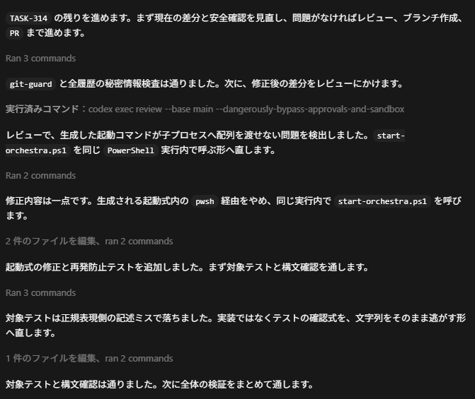

## はじめに

この記事を読み終えると、CodexのStop / SessionStartフックだけで日本語応答を検品するハーネスの仕組みと、その設計判断が分かる。

Codexでバイブコーディングしていると、チャット応答の日本語に英単語が裸で混ざり、技術用語が助詞でそのまま直結され、1文が長すぎることが頻発する。`parity` が助詞で直結され、`fail-close` が地の文に混ざり、1文に英語識別子が7個並ぶ。読めなくはないが、音読するとつかえる。応答ごとに解読の30秒を払う。1回は小さいが、使うほど積み上がっていく。

プロンプトで何度注意しても直らない癖を、仕組みで封じるためのハーネスを作った。[`Sora-bluesky/ja-output-harness`](https://github.com/Sora-bluesky/ja-output-harness) に置いてある。

https://github.com/Sora-bluesky/ja-output-harness

以前 `codex-jp-harness` という名前で、MCPサーバーを検品ゲートとして外付けする版を作っていた（現在はアーカイブ済み）。今回はCodex 0.120で公式公開された **Stop / SessionStartフック** に載せ替え、名前も `ja-output-harness` に変えて1から作り直している。ゴールも同じく、日本語応答を機械的に読みやすくするところ。

READMEだけでは伝わりにくい **なぜこの設計にしたのか** を書く。インストール手順やFAQは [README](https://github.com/Sora-bluesky/ja-output-harness) に任せ、ここでは設計判断と数字の扱い方に絞る。

## 先に結論

- **追加の応答トークンは基本0**。検品ロジックはCodexのLLM呼び出しの外側（Python）で走るため、応答トークンに1 byteも足さない
- 違反を検出したら、Codexが同じターン内で自己修正する。追加で走るのは違反が出たときだけで、継続推論1ターン分（既定の `strict-lite` モード）。違反ゼロなら0トークン
- 修正しきれなかった違反はJSONLに記録され、**次セッション起動時** に短い再教育プロンプトがCodexに渡る
- 実測の初手ok率は公開時点23.8%（n=21, Wilson 95% CI [10.6%, 45.1%]）→ 累積38.1%（n=354）。評価すべきはcontinuation後の最終品質のほう

実際、ハーネスを通した後のCodexの応答はこう見える。


*英語識別子（`TASK-314`・`PR`・`git-guard`・`start-orchestra.ps1`・`PowerShell`・`pwsh` など）が自動でバッククォートに包まれ、1文が短く刻まれている。音読しても詰まらない*

## 仕組み: 3段の処理が直列に動く

Codex 0.120で **Stop hook** と **SessionStart hook** という公式拡張ポイントが公開された。Codex本体にもOpenAIのコードにも手を入れず、この2つのフックだけで検品ループを構築している。

```
[Codex 応答] → Stop hook → (違反検出) → decision: block
                                     ↓
                         [Codex が continuation で自己修正]
                                     ↓
                         取りこぼし → JSONL に追記
                                     ↓
[次セッション起動] → SessionStart hook → 再教育プロンプト注入
```

### Stop hook: ターン終了の瞬間に応答を掴む

Codexが日本語応答を返した瞬間、StopフックにJSONペイロードが届く。ハーネスは応答文字列を取り出し、Pythonの検品ロジック（`ja_output_harness.rules_cli`）で違反を洗う。

検出ルールは素朴な組み合わせに抑えてある。

- **裸の英単語**: `parity` / `slice` / `pipeline` などをバッククォートなしで書いた箇所
- **技術比喩の流用**: `fail-close` / `fast-forward` / `handoff` を助詞で使った箇所
- **識別子過多**: 1文に英語識別子が3個以上
- **長文**: 1文80文字超（英語識別子を含む文は50文字超）
- **裸のPR / issue番号**: `PR #123` や `issue #42`

禁止語は [`config/banned_terms.yaml`](https://github.com/Sora-bluesky/ja-output-harness/blob/main/config/banned_terms.yaml) で追加・調整できる。プロジェクト固有の用語（公式用語としての `slice` など）は除外できる。

### 違反が出たらCodex本人に言い直させる（strict-liteモード）

違反があったら `{"decision": "block", "reason": "..."}` をCodexに返す。Codexは同じターン内で **continuation** を走らせ、違反内容を読んで自動で言い直す。

外部でハーネスがregex置換して文字列を差し替える手もあるが、やめた。**Codex本人に直させたほうが自然な日本語になる** からだ。外部置換だと違反語だけ消えて文脈が崩れ、別の読みにくさが生まれる。Codexに任せると文体の一貫性が保たれ、その応答全体がきれいになる。

代わりに、LLMが「直す」と言って直さないケースがある。そのぶんは次の層で拾う。

### 取りこぼしは翌セッションに繰り越す

修正しきれなかった違反は `~/.codex/state/jp-harness-lite.jsonl` に1行ずつ追記される。**SessionStartフック** は次のセッションが起動するとき（`source=startup|clear`）に発火し、未消化の違反を400文字以内に圧縮して「前回こういう違反があった」という短い再教育プロンプトをCodexに差し込む。

同じ違反を2セッション連続で踏むと再教育が強まる、という後方検知ループが動く。1ターンごとの完璧さは諦め、数セッション単位で均していく考え方。

## 追加トークンが基本0になる理屈

旧ハーネス（MCP finalizeゲート版）を使っているとき、実測で **+30〜50% の追加トークン** が発生していた。内訳はシンプルで、下書きが2回、Codexの出力に乗るから。

1. 1回目: 下書きを `finalize(draft=...)` のツール引数として吐き出す
2. 2回目: 整った版を最終応答として吐き出す

加えて、`finalize` のレスポンス（違反JSON）を次ターンで読むためのinputトークンも増える。CodexをChatGPTサブスクで使っている場合、週次・月次のリミットを3〜5割早く使い切る計算になる。作業の途中で「今週の枠が尽きました」に当たりやすくなる、というのが日常の痛みの形。

新ハーネスは構造を反転させた。

**検品がLLMの呼び出しの外側（Pythonプロセス）で走る**。Codexは下書きを1回出力するだけ。ハーネスはその出力をもらってPythonで検品し、違反があれば `decision: block` を返すだけ。応答トークンに1 byteも足さない。

違反時はcontinuationが1ターン分の再推論を走らせる。入力はプロンプトキャッシュで軽減され、推論と出力だけが再生成になる。ターン平均の増分は違反率に比例し、違反ゼロなら0%。違反率自体は `banned_terms.yaml` のチューニングで下げていく前提で、**継続推論を発火させないこと自体が運用の肝** になる。「下書きを毎回2回払う」旧構造に比べて、ならすと大幅に安い。

## 初手ok率の見方

記事公開時点（n=21）の初手 `ok: true` 率は23.8%、Wilson 95% CI [10.6%, 45.1%] だった。その後dogfoodのサンプルを積み上げ、n=354時点では38.1% に上がった。一見、通す率が低い。

ただしこれは **最終品質ではなく初手の通過率**。違反を拾ったあとCodexがcontinuationで自己修正するので、ユーザーに届くのは修正後の応答。JSONLを追うと、違反検出の約16秒後に `ok: true` が続いているケースが大半だった。

```jsonl
{"ts":"2026-04-22T02:06:01Z","session":"019daea0-…","ok":false,"violation_count":2,"rule_counts":{"sentence_too_long":1,"banned_term":1},"mode":"strict-lite", ...}
{"ts":"2026-04-22T02:06:17Z","session":"019daea0-…","ok":true,"violation_count":0,"rule_counts":{},"mode":"strict-lite", ...}
```

**「検品なしなら100% 取りこぼすはずのものが、2ターン目で整う」** という見方のほうが実像に近い。初手通過率を上げる方向にチューニングすると誤検知が増えるので、あえてリコール側に倒している。数字は厳しめに出て、continuationが拾う。

ルール調整で絶対値は動くので数字を絶対視せず、continuation後の最終品質で評価する。前作で出した「32→0」は特定ベンチ上の数字で、汎用運用でも同じになるとは限らなかった。今回は日常のdogfoodから取った数字を、信頼区間つきで置いた。

## 前作からの移行: 指示依存からフック駆動へ

前作との最大の違いは、**「検品係を呼ぶか呼ばないか」の判断をLLMに委ねなくなった** ことだ。

前作では、AGENTS.mdに「日本語応答のとき `finalize` を呼べ」という指示を書き、Codexがそれを読み取って `finalize` を発火させる構造だった。opt-outトリガー（v0.2.3）で取りこぼしはかなり減ったが、**指示が守られる確率** に信頼を預ける点は変わらなかった。

Stopフックが公式公開されたことで、前提が変わった。**応答が終わった瞬間に必ず発火する**という決定性が、ランタイム側で担保された。AGENTS.mdで指示が揺れても、フックは必ず走る。ここを移すことで、ハーネスのコアロジックが「呼んでもらう設計」から「勝手に走る設計」に変わった。

同時に、Codex本人に言い直させる方針に切り替えたことで、検品の中心がPythonからLLMに戻った。Pythonの役割は「違反の通知」だけ。文字列の修正はLLMに任せる。責務を分離したほうが、それぞれの得意な仕事に集中できる。

## いつ捨てるか

これは暫定対策である。公式のCodexが日本語自然化を標準装備した日、このリポは役目を終える。`docs/DEPRECATION.md` に撤去条件を先に書いた。「いつ捨てるか」を先に決めると、今必要な最小限だけ作ればよくなる。未来永劫メンテすると思うと機能を足し続けてしまう。

補足しておくと、今のところCodex本体で「日本語を厳しく整える」動きは見えていない。ハーネスはしばらく役目を持ちそうだが、そう決め込まずに済むような設計に保つこと自体が、このリポのひとつの設計判断でもある。

## まとめ

Codexの公式フックだけで、日本語応答を検品して自己修正させるハーネスが動く状態になった。内訳は次のとおり。

- **Codex 0.120の公式フック（Stop / SessionStart）だけで検品ループを組んだ**。本体には一切手を入れない
- 検品はLLMの外側で走るため、**追加の応答トークンは基本0**。違反時のみcontinuationで1ターン分を追加消費、ターン平均は違反率に比例
- 違反が出たら `decision: block` を返し、Codex本人に言い直させる（`strict-lite` モード）。文体の一貫性が保たれる
- 取りこぼしはJSONLに記録し、SessionStartフックで翌セッションに繰り越す
- 初手ok率は実測23.8%（n=21, 公開時点）→ 38.1%（n=354, dogfood累積）。評価すべきはcontinuation後の最終品質
- 前作の `codex-jp-harness` はMCP外付けで +30〜50% のトークンを支払っていた。今回は構造反転で0に

インストール手順やFAQ、ルールのカスタマイズは [README](https://github.com/Sora-bluesky/ja-output-harness) に整えてある。

https://github.com/Sora-bluesky/ja-output-harness

最後に。OpenAIの日本語対応を誰よりも早く迎え入れて、このリポを役目終わりにする日を楽しみにしている。

> **最終更新**: 2026-04-24。実測サンプルをn=21 → n=354まで積み上げた時点の数字を反映。continuationコストを「1ターン分」として書き直した。

---

**関連リンク**

- GitHub: [`Sora-bluesky/ja-output-harness`](https://github.com/Sora-bluesky/ja-output-harness)
- [OpenAI Codex CLI](https://github.com/openai/codex)
- 関連Issue: [#17132](https://github.com/openai/codex/issues/17132), [#17532](https://github.com/openai/codex/issues/17532)
