:::message
**この記事をAIに読ませる**

この記事はGitHubの公開リポジトリで管理していて、本文のMarkdownをそのまま取得できる。Claude CodeやCodexなどのAIエージェントに手順を任せたいときは

https://raw.githubusercontent.com/Sora-bluesky/zenn-articles/main/articles/obsidian-skills-agent-shared-vault.md

頼み方の例:「この記事を読んで、私の環境で手順を順番に実行して」に上のURLを添える。
:::

僕はClaude Code・Codex・Museなど、いくつものAIエージェントでObsidianの保管庫を1つ共有する。

それでもAIエージェントを替えるたびに、同じ指摘をくり返した。

Obsidianのメモの書き方(リンクの付け方や、メモ先頭のプロパティ)の指摘もその1つ。

これは指示書(スキル)にしてあり、Claude Code用のスキルフォルダと、ほかのAIエージェントが読む共通のスキルフォルダに1つずつあった。

ただ、その指示書は古いままで、中身は公式の最新版とずれたまま。

そこで僕は、この指示書をObsidian公式のプラグイン(obsidian-skills)に切り替えた。

今は、まだ試してないdotsを除く全AIエージェントが、公式の指示書を読む。

公式版を入れたのは、Claude Code・ChatGPT/Codexアプリ・Muse・Hermes Agentの4つ。

Codex CLI・Grok Build・Antigravity CLI・Cursorは、共通のスキルフォルダ(`.agents\skills`)で済ませた。

そこにある古い版を、公式版に置き換えただけ。

きっかけは、Obsidian公式の発表。

「すべてのエージェント向けの公式コネクタ」として公開された([Obsidian公式の案内ページ](https://obsidian.md/help/connectors))。

https://x.com/obsdmd/status/2125700941156651151

## この記事でできるようになること

- Obsidianの書き方の指摘を、AIエージェントごとにくり返さなくて済む
- 公式スキルを入れたAIエージェントが書いたメモは、Obsidianの書き方(wikilinkやプロパティ)がそろい、リンクでつながる
- 書き方の指示書を、公式版にそろえられる
- クラウドAIが書いたメモを、翌日を待たずにパソコンのObsidianへ取り込む構成が分かる
- つまずきやすい所を、先に避けられる

## 対象読者と環境

読者は、Claude Code・Codex・ChatGPTなど複数のAIを使い分け、AIを替えるたびに同じ前提や同じ指摘をくり返すのをやめたい人。

Obsidianの保管庫(vault。メモのフォルダ全体のこと)を使った経験があれば足りる。

僕の環境は次のとおり。

- 自分のパソコン(Windows)にObsidianと、共有メモ用の保管庫がある
- その保管庫はGitHubの非公開リポジトリにも置いてある
- 使うAIは、Claude Code・Codex・Grok Build・Antigravity・Cursor(パソコン側)と、Muse・Grok Bot・dots(クラウドのChatGPT)・VPS(借りて使うサーバー)のHermes Agent(クラウド側)
- 公式プラグイン(obsidian-skills)の版は1.2.3

僕の環境はWindowsだが、ObsidianにもClaude Codeなどのツールにも、macOS版とLinux版がある。

この記事の手順を確かめたのはWindowsだけ。macOSやLinuxでも、同じ構成でできるはず。

なお、クラウドAIのメモを取り込む部分は、GitHubの非公開リポジトリ・追記専用の受け口(Cloudflare Workersで作る)・定期タスクを自分で用意する必要がある。

この記事では、その部分は構成と結果の紹介にとどめる。

## AIを替えるたびに同じ説明をくり返すのはなぜか

コンテキストは、AIが作業の前に読む前提のこと。

なかでもいちばん大事なのは、人がAIに出した指摘。

この記事の下書きでも、僕はAIに「具体的すぎる時刻は書かない」「自分しか知らない名前は使わない」と何度も直した。

この指摘は、どこかに書いて共有しないかぎり、直したAIのセッションにしか残らない。

AIは、別のAIのセッションで何があったかを知らない。

共有しないと、AIを替えるたびに同じ指摘をくり返すことになる。

あるAIの結果を別のAIへ回すのも、人がチャットからコピーして貼る中継になる。

僕がMuseとAntigravityをつないだのも、このコピペの中継をやめるためだった。

そこで僕は、全部のAIが読む共有メモの置き場として、Obsidianの保管庫を1つ作った。

ただ、置き場を作っただけでは、書き方の指示書はスキルフォルダごとに別々のまま残る。

置き場がそろえるのは、どこを読むかまで。

どう書くかは、AIごとに別に教える必要がある。

メモには、Obsidian独自の書き方がある。

wikilink(`[[ノート名]]`の形でノート同士をつなぐリンク)や、プロパティ(メモ先頭のタイトルや日付の欄)がそれ。

これを教える指示書(スキル。SKILL.mdというファイル)は、Claude Code用のスキルフォルダと、他のAIが読む共通のスキルフォルダに1つずつあった。

別々のファイルなので、公式が更新されても古いまま残る。

公式の最新版と比べると、どれも中身がずれていた。

ずれがいちばん大きいのはobsidian-basesで、しかも更新する手段がなかった。

クラウドAI(Muse・Grok Bot・dots)には、そもそも書き方の指示書がない。

頼りは、保管庫のAGENT_INSTRUCTIONS.mdに書いた文章のルールだけ。

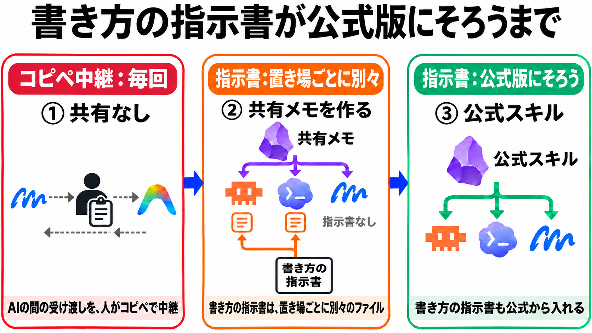

## 共有メモ1か所と公式スキルで、同じ指摘をくり返さない

僕の共有メモは、読み書きの経路をパソコンのAIとクラウドAIで分ける。

- パソコンのAI(Claude Code・Codex・Grok Build・Antigravity・Cursorなど)は、パソコンのファイルを直接読み書きする。セッションのログは、1日1回のタスクで保管庫に集める
- クラウドAI(Muse・Grok Bot・dots・VPSのHermes Agent)は、GitHubを読み取り専用で読む。書くときは、Cloudflare Workersで作った追記専用の受け口に送る。受け口は新しいファイルを作るだけで、既存のファイルの上書きと削除はできない。秘密情報らしい文字列は弾く
- 集まったメモをナレッジベース(テーマごとのノート)にまとめる作業は、パソコンの1日1回のタスクだけが行う

GitHubを読み取り専用にして書き込みを受け口に分けたのは、既存のファイルの誤上書きを防ぐため。

共通ルールは保管庫のAGENT_INSTRUCTIONS.mdに書き、各AIがそれを読む。

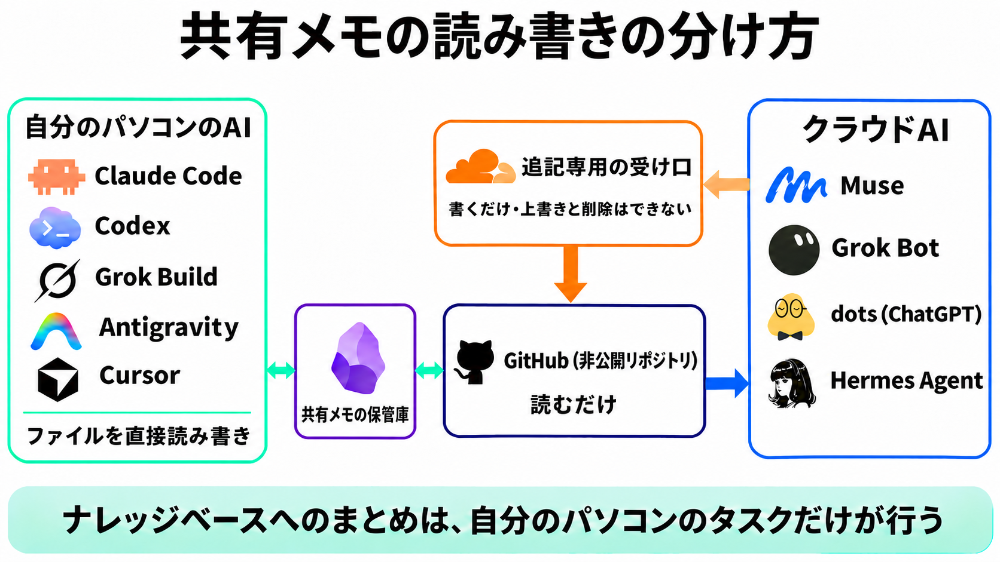

この形で残っていた問題は2つ。

1つは、前の節で書いた、スキルフォルダごとに別々の書き方の指示書。

もう1つは、クラウドAIが送ったメモが、パソコンに届くのが遅いこと。

GitHubからパソコンへの取り込みは、1日1回のタスクに任せた。

そのタスクは、パソコン側に送る新しい変更(コミット)がない日は、取り込まずに終わる作りだった。

そのため、クラウドAIが昼に送ったメモは、翌朝のナレッジベースへのまとめのタスクまでパソコンに届かない。

僕は1つ目を公式スキルへの切り替えで、2つ目を1時間に1回の取り込みで解いた。

## 公式プラグイン（obsidian-skills）の中身

実体は、GitHubの[obsidianmd/obsidian-skills](https://github.com/obsidianmd/obsidian-skills)。

MCPサーバー(AIに外の機能をつなぐ仕組み)ではなく、スキル7本が入る。

| スキル | 役割 |
|---|---|
| obsidian-markdown | wikilink・埋め込み・callout(目立たせる囲み)・プロパティの書き方 |
| obsidian-bases | `.base`ファイル(メモをデータベースのように並べる機能)の書き方 |
| json-canvas | `.canvas`ファイル(図を描くキャンバス)の書き方 |
| obsidian-cli | 起動中のObsidianをコマンドで操作する |
| obsidian-headless | Obsidian SyncとPublishを、アプリを起動せずに扱う |
| defuddle | WebページをMarkdownに変換する |
| knap | テンプレートからMarkdownを作る |

MCPサーバーも同期機能も入らない。

[Hermes Agentのプラグインカタログ](https://hermes-agent.nousresearch.com/marketplace/obsidian)の説明も同じで、こう書いてある。

「instructions only: no code, MCP servers, hooks or background processes」

(和訳:指示だけ。コード・MCPサーバー・フック・常駐プロセスは含まない)

## 各AIへの入れ方は4通り

入れ方はAIによって4通り。dotsからはまだ試してない。

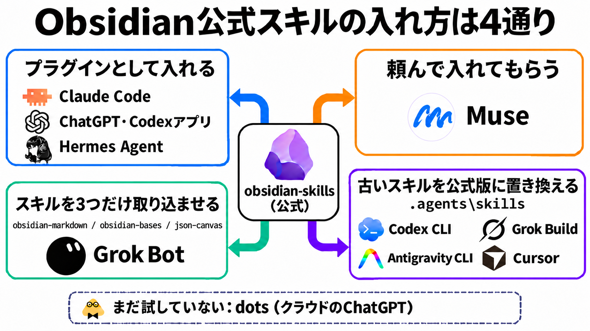

### Claude Code

コマンドは次の2行。

```
claude plugin marketplace add obsidianmd/obsidian-skills
claude plugin install obsidian@obsidian-skills
```

更新は`claude plugin update obsidian@obsidian-skills`で行う。

### ChatGPT/Codexアプリ

設定、プラグイン、Obsidianの順に追加する。

7本のスキルは1本ずつオンとオフを切り替えられる。

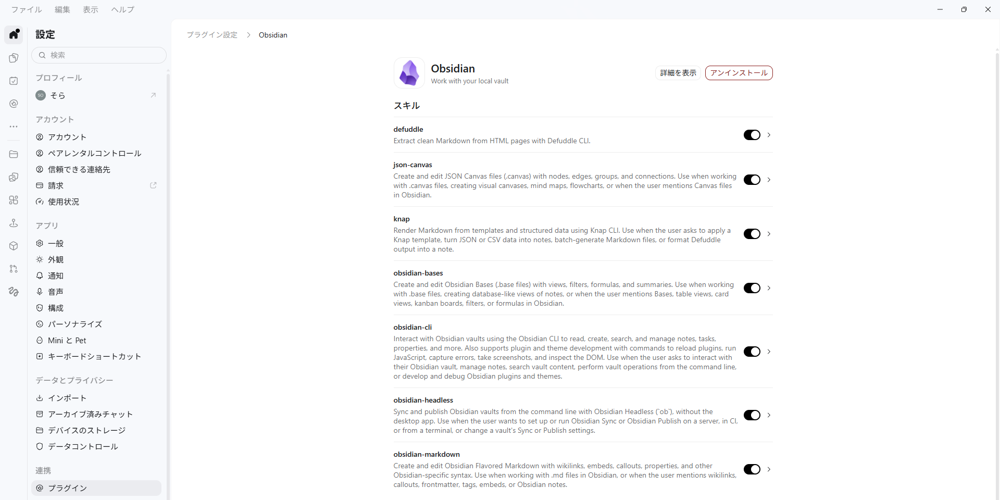

### Muse

僕が「公式のobsidian-skillsを入れて」と頼むだけで、7本が入った。

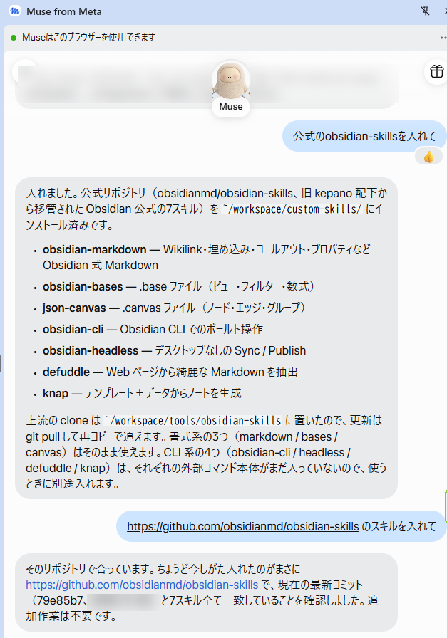

Museはクラウドで動くので、obsidian-cliは使えない。

### Grok Bot

プラグイン一覧からの追加はできた。

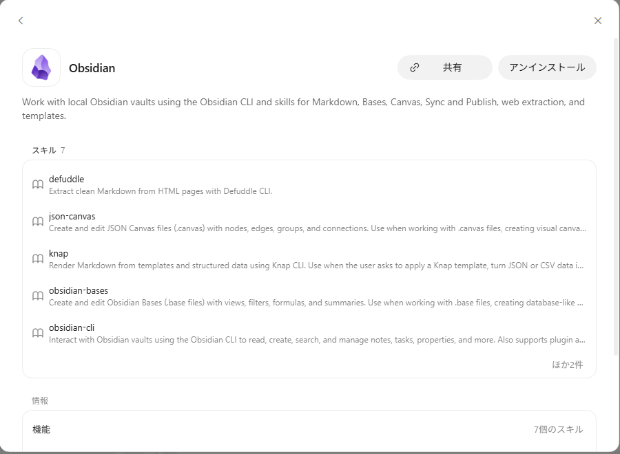

ただ、スキルとしては出てこなかった。

そこで僕は、Obsidianのファイルの書き方を教える3本を、Grok Botのスキルとして取り込ませた。

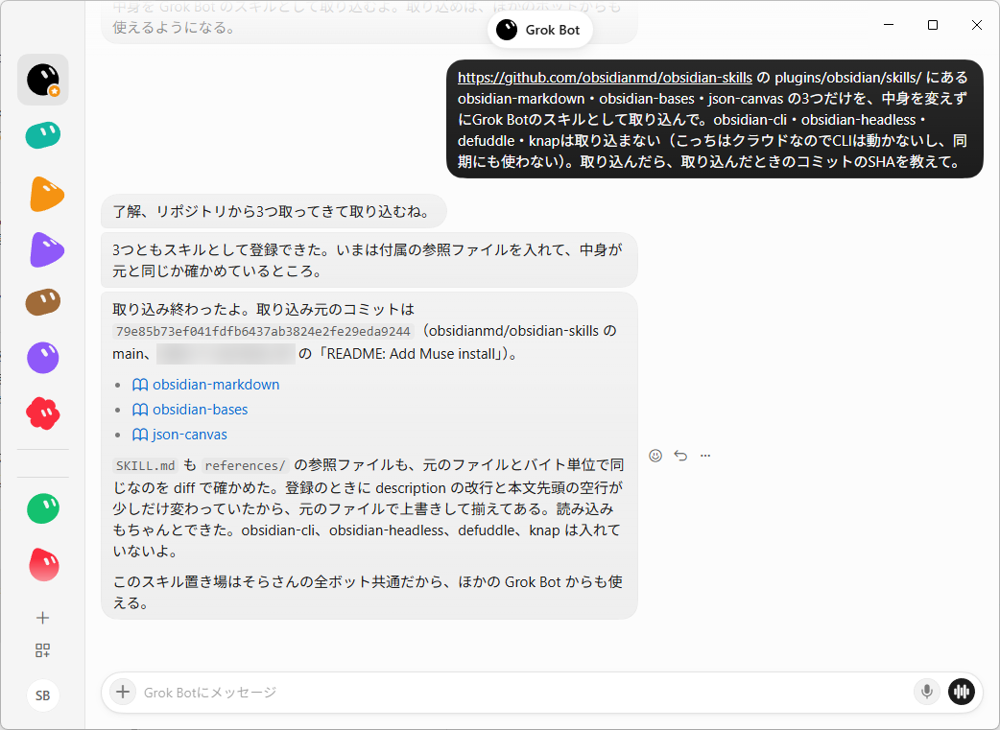

3本は次のとおり。

- obsidian-markdown(普通のメモ)
- obsidian-bases(.baseファイル)
- json-canvas(.canvasファイル)

詳しくはつまずきポイントに書く。

### Hermes Agent（VPS）

インストール(install)のあとに、有効化(enable)まで打つ。

```
hermes plugins install obsidian
hermes plugins enable obsidian
```

### 共通のスキルフォルダを読むAI

Codex CLI・Grok Build・Antigravity CLI・Cursorが読むのは、パソコンの同じスキルフォルダ。

場所はホームフォルダの`.agents\skills`。

ここにある古い版を公式版に置き換えるだけで済み、プラグインを別に入れる必要はなかった。

Antigravity CLIに「使えるスキルを挙げて」と頼んだ結果は次のとおり(ユーザー名は伏せてある)。

```
defuddle（~/.agents/skills/defuddle/SKILL.md）
json-canvas（~/.agents/skills/json-canvas/SKILL.md）
obsidian-bases（~/.agents/skills/obsidian-bases/SKILL.md）
obsidian-cli（~/.agents/skills/obsidian-cli/SKILL.md）
obsidian-markdown（~/.agents/skills/obsidian-markdown/SKILL.md）
```

最後に、僕はAGENT_INSTRUCTIONS.mdへ次の文を書き足した。

「Obsidianの書式は公式スキルに従う。このファイルのルールと食い違ったら、このファイルを優先する」

## 動作確認：MuseのメモがObsidianのグラフでつながるまで

僕はMuseに頼んで、公式スキルを使ったメモを1件書いて、共有メモに送ってもらった。

依頼文で頼んだのは次の5つ。

- obsidian-markdownスキルを使う
- frontmatter(プロパティの欄)にtitle・created・tags・sourceを入れる
- 見出しを6つ付ける
- wikilinkを2つ(AGENT_INSTRUCTIONSとobsidian-skills)入れる
- calloutを1つ入れる

結果は成功だった。

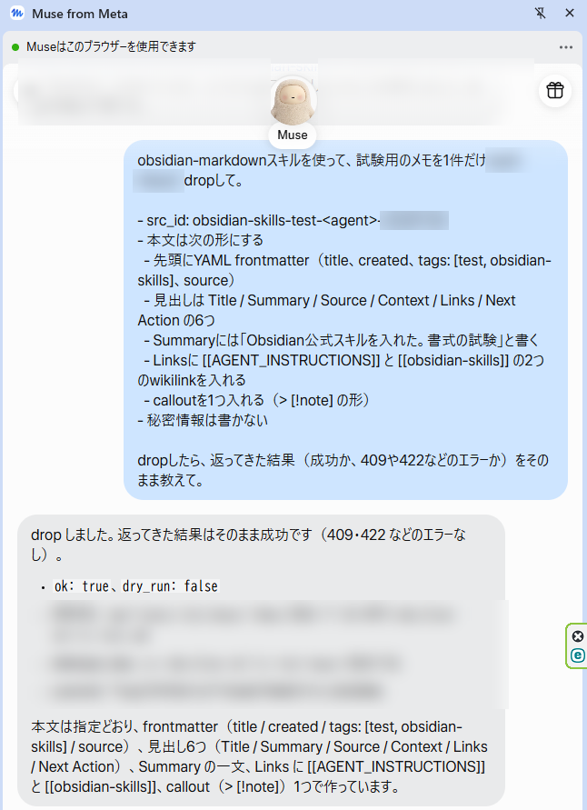

届いたメモをGitHubで開くと、書式はすべて公式のとおり。

クラウドAIのメモを早く届けるために、僕はGitHubから1時間に1回取り込むタスクを足した。

取り込むのはfast-forward(早送りマージ。パソコン側の履歴に、そのまま新しい履歴を継ぎ足せる状態)にできるときだけ。

パソコン側と食い違っていたら何もしない。

毎朝のタスクと重なる時間帯は、取り込みを休む。

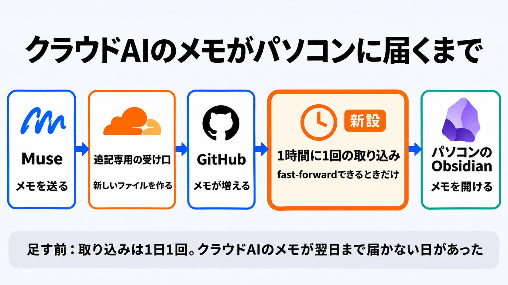

パソコンのObsidianでそのメモを開くと、プロパティの欄、「試験メモ」のcallout、2つのリンクが表示された。

AGENT_INSTRUCTIONSはノートがあるので濃い色、obsidian-skillsはまだノートがないので薄い色で表示される。

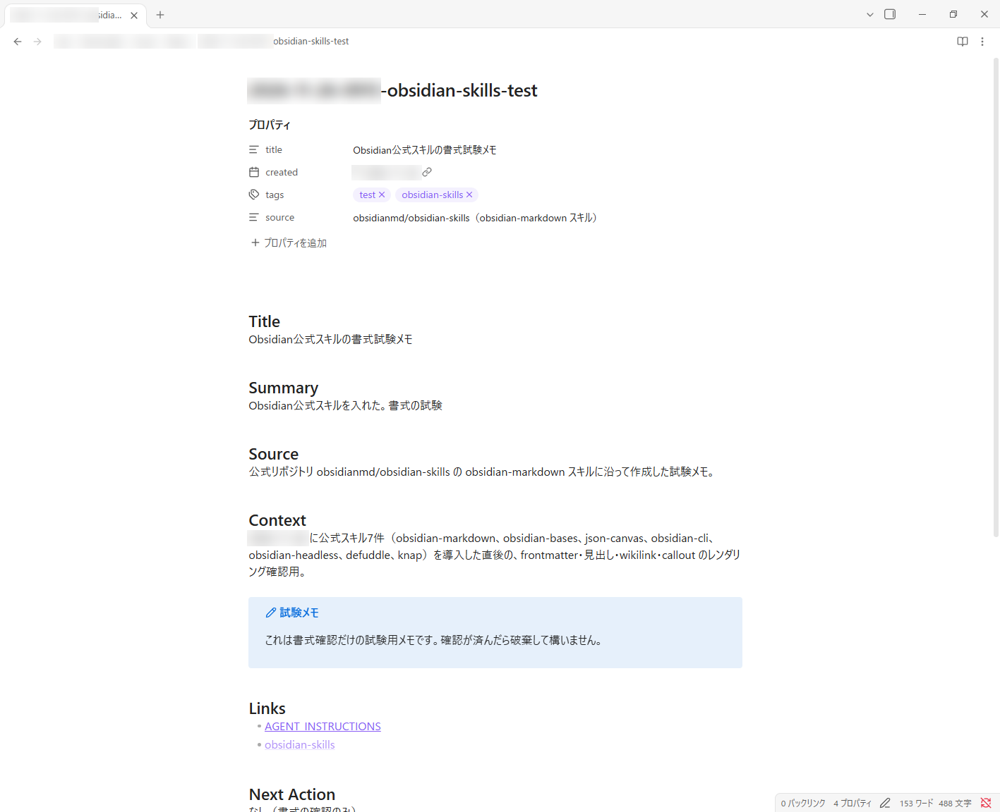

ローカルグラフでは、Museのメモ・AGENT_INSTRUCTIONS・obsidian-skillsの3つが線でつながった。

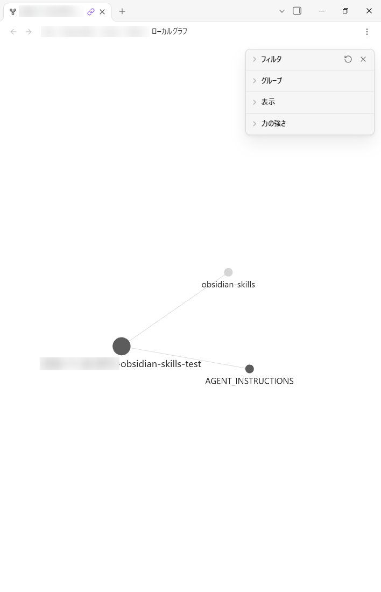

## つまずきポイント

### 古い版の退避先をスキルフォルダの中にすると、Cursorが二重に読む

はじめは、古い版を`skills`の下の`disabled`フォルダに退避した。

するとCursorはその中まで読み込み、同じ名前のスキルが2つずつ出た。

退避先は、スキルフォルダの外にする。

### 共通のスキルフォルダの公式版は、自動では新しくならない

Claude Codeのプラグインは、`claude plugin update obsidian@obsidian-skills`で新しくなる。

共通のスキルフォルダに置いた公式版は、その更新では新しくならない。

僕はプラグインを更新したら、共通のスキルフォルダの公式版も、AIエージェントにプラグインのフォルダから写し直させる。

### Grok Botは、プラグイン一覧から追加してもスキルに出ない

プラグイン一覧からの追加はできる。

新しいチャットを開いても、スキル一覧には出てこなかった。

そのため僕は、書き方の3本をスキルとして取り込ませた。

### Hermes Agentは、入れた直後は無効

`hermes plugins install obsidian`だけでは使えず、`hermes plugins enable obsidian`が要る。

### obsidian-cliは、失敗しても終了コード0を返す

obsidian-cliは、Obsidianのデスクトップアプリが起動中で、CLIが有効なときだけ動く。

失敗しても終了コード(コマンドが成功したかを表す数字)0を返すので、出力を見て判断する。

これは[公式スキルの本文](https://github.com/obsidianmd/obsidian-skills/blob/main/plugins/obsidian/skills/obsidian-cli/SKILL.md)に書いてある。

### dots(クラウドのChatGPT)からは、まだ試してない

[Obsidian公式の案内ページ](https://obsidian.md/help/connectors)が挙げる、このプラグインの対応先はChatGPT・Codex・Dots。

一方、僕の環境のChatGPT/Codexアプリでは、プラグインの説明に「デスクトップ専用。Obsidianを起動してCLIを有効にしておく必要がある。MCPは今後対応」と書いてあった。

そのため僕は、dotsからはまだ試してない。

## 入れなかったもの

### obsidian-headless(Obsidian Sync)

僕は使わなかった。

dotsとMuseはGitHub連携で読むので、Gitは外せない。

双方向の同期を足すと、「受け口は追記だけ」「ナレッジベースへのまとめは1か所だけ」という決まりが崩れる。

### Antigravityの利用規約

[Antigravityの利用規約](https://antigravity.google/terms)の第6項(2026年11月26日に確認)には、こう書いてある。

第三者のソフト・ツール・サービスでAntigravityにアクセスすることは規約違反で、アカウント停止の理由にもなりうる、という内容。

例に挙がるのは「OpenClawでAntigravityのOAuthを使う」。

そのため僕は、Museなどほかのツールから、Antigravityを自動で動かさない。

自分で「確認して」と1行打って動かす。

僕の𝕏のポストには、「Muse VMにAntigravityを入れてMuse経由で叩くのもアウト？」という質問が付いた。

https://x.com/sora_biz/status/2125563378047582693

この使い方が規約に当たるかどうかについては、規約の文面を示すところまでにとどめる。

## 切り替えて変わったこと

僕は、共有メモの書き方の指示書を、スキルフォルダごとに別々の指示書から、公式のスキルに切り替えた。

確かめられたのは次のこと。

- Claude Code・ChatGPT/Codexアプリ・Hermes Agentはプラグインとして、Museは頼むだけで、公式版が入った
- Codex CLI・Grok Build・Antigravity CLI・Cursorは、共通のスキルフォルダの古い版を公式版に置き換えるだけで済んだ
- Grok Botは一覧から追加できてもスキルに出なかったので、ファイルの書き方を教える3本を取り込ませた
- クラウドAIが送ったメモを取り込むため、1時間に1回のタスクを足した。手で1回動かすと、パソコンのObsidianに届いた
- 受け口の「追記だけ」と、ナレッジベースへのまとめの「1か所だけ」という決まりは、そのまま残した

引用元は次のとおり。

- [Obsidian公式の𝕏の発表ポスト](https://x.com/obsdmd/status/2125700941156651151)
- [Obsidian公式の案内ページ(コネクタ)](https://obsidian.md/help/connectors)
- [obsidianmd/obsidian-skills(GitHub)](https://github.com/obsidianmd/obsidian-skills)
- [Hermes Agentのプラグインカタログ(obsidian)](https://hermes-agent.nousresearch.com/marketplace/obsidian)
- [Antigravity利用規約](https://antigravity.google/terms)
