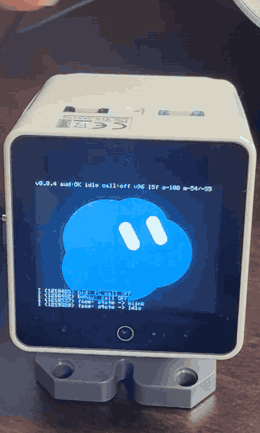
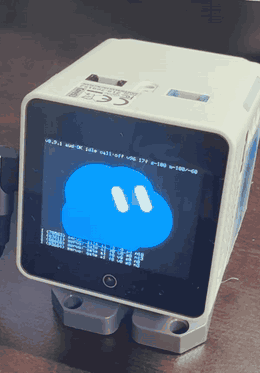
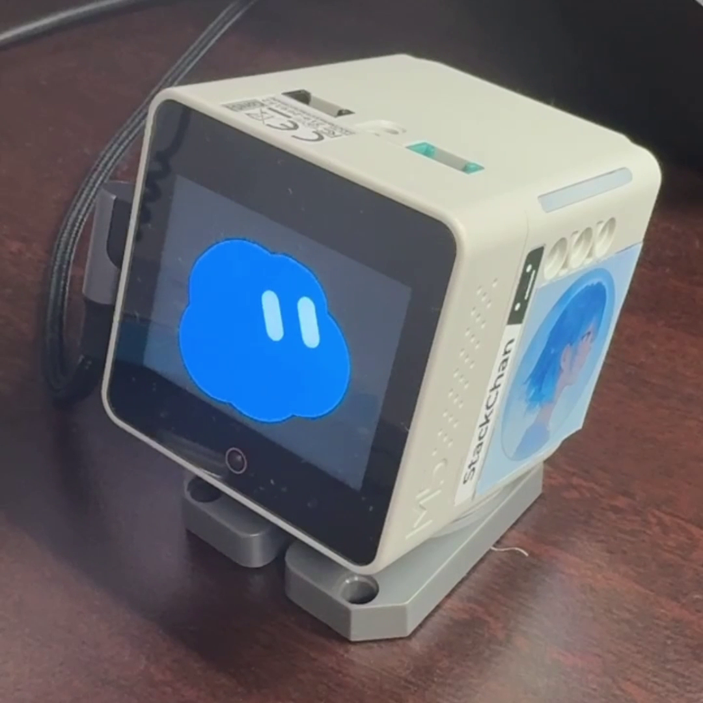
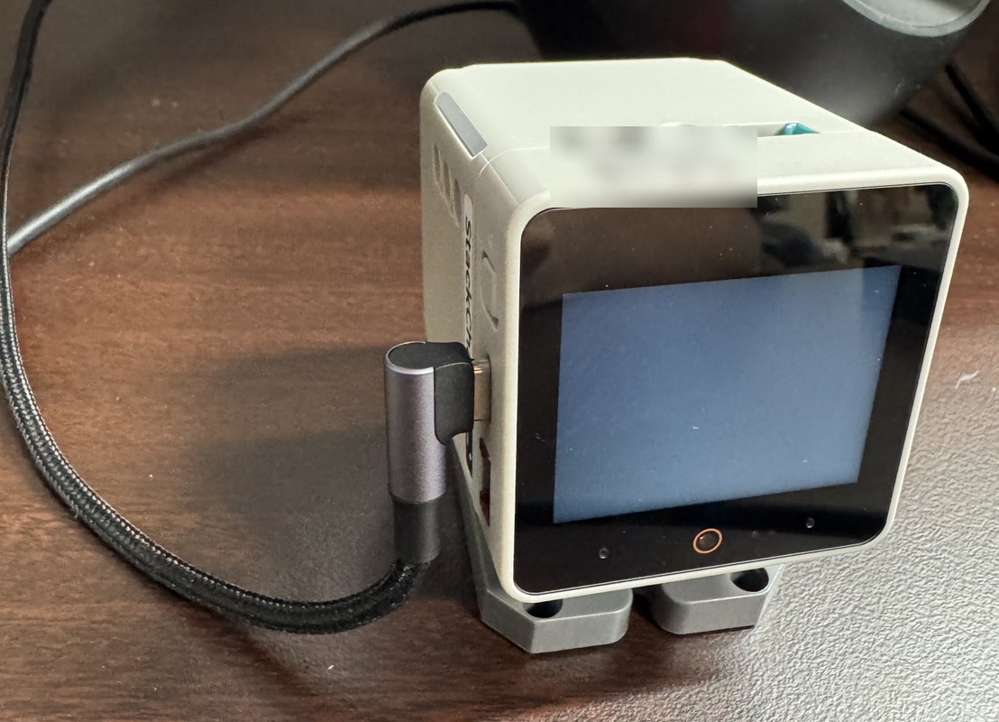

ｽﾀｯｸﾁｬﾝの頭を、指で2回トントン。

それだけで、PCのGrokのデスクトップアプリで**音声通話が始まる**。

話す声はｽﾀｯｸﾁｬﾝのマイクが拾って、Grokの返事はｽﾀｯｸﾁｬﾝのスピーカーから聞こえる。

ｽﾀｯｸﾁｬﾝは、画面の顔と首が動く手のひらサイズのロボット。それをPCのマイク兼スピーカーにするファームウェアを作った。

「GitHubで公開しよかな？いらねーか（笑）」ってポストしたけど、結局公開しました。

https://github.com/Sora-bluesky/stackchan-desk-voice

:::message
非公式のファンメイドです。

xAI・M5Stack・ｽﾀｯｸﾁｬﾝプロジェクトとは関係がなく、承認も受けてません（クレジットは記事の最後に）。
:::

## スマホで話せるのに、なんでわざわざ？

って思いますよね。

Grok Botと話すだけなら、スマホのアプリでもデスクトップアプリでもできる。

それでもｽﾀｯｸﾁｬﾝを使う理由は、**単純にかわいいから**。あと、考えたことが形になる喜びを味わいたい。ただそれだけ。大きな理由はない。

話しかける相手は、スマホの画面より、顔のあるやつがよかった。

話しかけると、ちゃんとこっちを向く。首を振るときは先に目が動いて、首があとから付いてくる。

これがかわいい🥰

## できるようになった6つのこと

- PCにつなぐと、マイクとスピーカーとして使える
- 画面には、コードで描いた青い雲の顔
- 待機中・聞いてるとき・考えてるとき・話してるときで、顔が切り替わる
- 画面を指で触ると、目が指を追う
- 頭を2回たたくと音声通話が始まり、もう一度2回たたくと終わる
- 待機中は20〜30秒おきに、首を動かして向きを変える

コードを書くのも、ビルドや書き込みのコマンドを打つのも、Claude Codeに任せた。

## USBケーブル1本でつながってるだけ

本体とPCは、USB-Cケーブル1本でつながってるだけ。

頭を2回たたくと、本体はUSBキーボードとして、ふつうのキーボードには無いF13キーを送る。

PC側の小さなスクリプト（操作を自動にするプログラム）がそれを受けて、Grokの音声ボタンをクリック。

スクリプトは、AutoHotkeyというWindows用のソフトで書いた。

通話中かどうかは、PC側がキーボードのScroll Lockランプを点けて本体に知らせる。本体はランプを見て、顔を切り替える。

**キーボードのランプで、PCから本体に合図を送ってるわけ。**

で、なんでこんな回り道かというと、Grokのアプリは通話が終わってもマイクを使ったままだから。

「マイクが使われてたら通話中」とは判断できなかった。

## 苦労した3つのつまずき

苦労したのは「音」と「頭トントン」。あと首。

動画を撮るのは僕、ログと動画の数字を読むのはClaude Code。**毎回ログを出して、数字で原因を見た**のが、いちばん助かった。

### 音が小さい。原因は、Windowsが音量を送ってこなかったこと

会話はできたけど、PCの音量を100% にしても声が小さい。

音量の上限を上げても、声の音量をソフトで上げる処理を足しても直らない。

ログを見ると、本体の音量がずっと半分のまま。

本体は起動したとき音量を低めにしてたのに、Windowsには「いまは最大」と返してた。

だからWindowsは、音量を送り直してこなかったわけ。

起動時の音量を最大に合わせたら解決。ソフトで上げる分は0に戻した。

### 頭トントンの2回目が消える

最初は、2回に1回は空振りしてた。

ログを見ると、1回目のタップしか記録されてない。

最初の原因は、頭のセンサーを読む間隔。

顔の描画と同じタスク（並行して動く処理の単位）で、約66 msごとにしか読んでなかった。

素早いタップはそのすき間に入って、気づけない。そこで、センサーだけを細かく読むタスクを作った。

それでも、まだ約半分が失敗。

センサーの生の値をログに出して、動画の指と1回ずつ見比べたら、失敗した回は値が1行も出てない。

**センサー自身が「触れてない」と返してた。**

これじゃ、ファームの判定をいくら直しても拾えない。

センサーの感度は、M5StackのStackChan用ライブラリ（StackChan-BSP）の値に合わせて上げた。

これで **7回中6回成功**。

何も触れてない約18秒のあいだ、誤反応もなし。

### 首が動かない、と思い込んだ

首を動かす版の動画を数字で見て、「首が動いてない」と判断。

次の版で、首を振る条件とモーターへの書き込み結果をログに出したら、ちゃんと動いてた。

なんだ、動いてたのか！

頭の動きを、カメラの揺れと読み違えてた。動画を見直して、目が先、首があとの順に動くのを目で確かめた。

## まだできないこと

- エコーキャンセル（スピーカーの音をマイクが拾い直さないようにする処理）はない。アプリ側のエコー対策を使うか、音量を控えめにする
- 通話中かどうかはウィンドウを見て決めるので、最小化すると「通話してない」扱いになる
- **PC側のスクリプトはWindows専用**
- 確かめたのはGrokのデスクトップアプリだけ。ほかのアプリは、ボタンの探し方を合わせる必要がある

## 自分のｽﾀｯｸﾁｬﾝで試すなら、守ってほしい5つ

ここからは、自分のｽﾀｯｸﾁｬﾝに書き込む人向け。

手順と、Claude Codeなどのエージェントへの頼み方の例はREADMEにまとめてある（リンクは記事の最後）。

買ったときのファームは、首のモーター（サーボ）の原点の値など、本体ごとのデータを本体の中に持ってる。

このファームも同じデータを読むので、**次の5つは必ず守ってください**。

- 最初にフラッシュ（本体の保存領域）16 MBをまるごとバックアップする
- 本体のパーティションテーブル（フラッシュの区画の表）に、0x20000から始まるアプリ用の領域があるかを確かめる。無ければ書き込まない
- 書き込むのはアプリイメージ（ビルドでできる `.bin` ファイル）だけで、場所は0x20000
- フラッシュの消去（`erase-flash` やWeb版ツールの「Erase」ボタン）はしない
- 書き込みは自己責任で

書き込んだあとも元のファームが起動するなら、別の領域から起動してる状態。バックアップを書き戻して、そこで止めてください。

## Grok以外のアプリでも動く？

確かめたのは、Grokのデスクトップアプリだけ。

これからHermesとかdotsも試してみようと思ってる。

ファームとPC側のスクリプトは、ここで公開中。

https://github.com/Sora-bluesky/stackchan-desk-voice

:::message
ｽﾀｯｸﾁｬﾝ（Stack-chan）の作者は、ししかわ（Shinya Ishikawa）さん。

本家のリポジトリは https://github.com/stack-chan/stack-chan です。

このファームのライセンスはMIT。

参考にしたコードと第三者のライセンスは、リポジトリのNOTICE.mdにまとめてます。
:::
