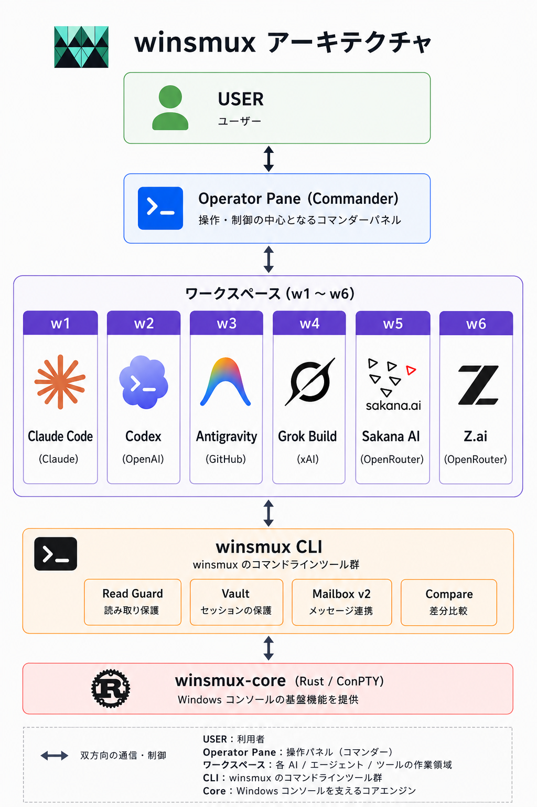
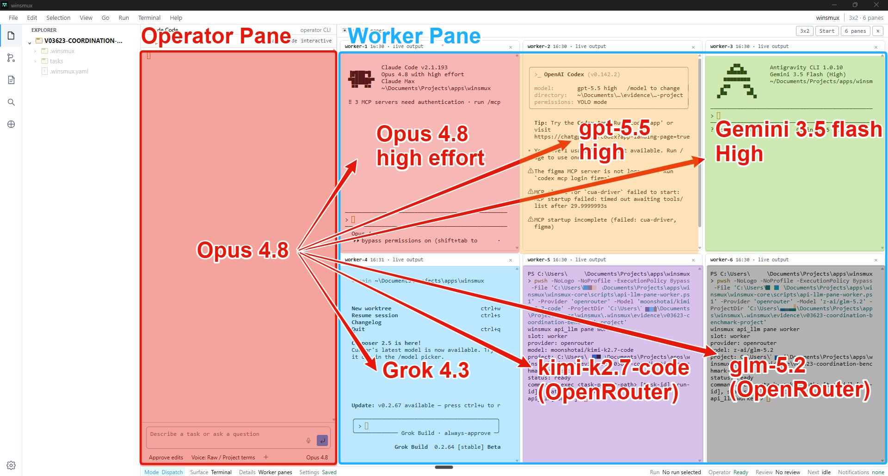
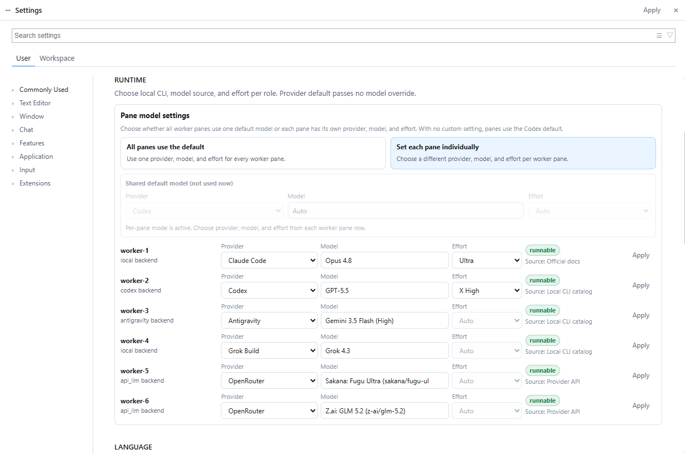

この記事を読むと、Windowsで複数のコーディングエージェントを別ペインで並走させるwinsmuxの構成・導入手順・使い方が分かる。macOS / Linux向けのsmux自体の導入は扱わない。

Claude Codeを司令塔にして、Codexに実装させ、別のCodexにレビューさせたい。調査はAntigravity CLIに回してコストも抑えたい。それぞれが何をやっているか、ペインで見える化もしたい。macOSならsmuxがある。でも僕の環境はWindowsだ。

WSL2を経由すればtmuxは使える。ただ、Windows TerminalとPowerShellで完結させたかった。ネイティブで動かないと、結局もう一枚レイヤーを噛ませることになる。それが嫌だった。

そこで作ったのが **winsmux** だ。当初はsmuxのWindows移植としてpsmux-bridgeを書いたが、現在は単独の `winsmux` CLIとRust製ランタイム `winsmux-core`、そしてTauri製のデスクトップアプリが束になった「Windowsネイティブの管制デスク」になっている。Claude Code、Codex、Antigravity CLIを同じワークスペースで並走させ、ペイン制御・worktree分離・資格情報保護・実行結果の比較・レビュー証跡までを一体で提供する。

https://github.com/Sora-bluesky/winsmux

@[tweet](https://x.com/sora_biz/status/2038184690361016626)

## smuxの発想が良かった

winsmuxの話をする前に、元ネタのsmuxについて触れておく。

smuxは [ShawnPana](https://github.com/ShawnPana) が作ったAIエージェントのマルチペイン運用ツールだ。構成はシンプルで、tmuxと、tmuxのペインを読み書きするCLI（tmux-bridge）の2つだけ。

エージェントは `tmux-bridge read` で他のペインの出力を読み、`tmux-bridge type` でテキストを入力し、`tmux-bridge keys Enter` で実行する。ペインの内容がそのまま通信チャネルになる。特別なプロトコルもメッセージキューもいらない。

この「ターミナルペインを通信チャネルにする」という発想がいい。ただしtmuxはmacOSとLinux限定。Windowsでは動かない。

同じ領域のツールにはcmux、claude-squad、Claude Code Bridge、Agent Deck、dmuxなどがある。だが「Windowsネイティブ」「ターミナルマルチプレクサ」「AIエージェント間のクロスペイン通信」の3つを同時に満たすツールは、調べた限り存在しなかった。

## winsmuxのいま

winsmuxはpsmux-bridgeというWindows用PowerShellブリッジから始まり、その後Rust製ランタイム `winsmux-core` を取り込み、Tauri製のデスクトップアプリまで持つ管制デスクに進化した。

現在の構成は3層になっている。

- **`winsmux` CLI**：人間とエージェントが叩く統一インターフェース
- **`winsmux-core`**：ConPTY（Windowsのネイティブ擬似端末）を使うRust製のターミナルランタイム
- **デスクトップアプリ**：Tauri + xterm.jsで組んだ専用の管制画面。プロジェクトを選んでオペレーターとworkerのペインを並べる。ワークスペース自体は `winsmux launch` が立ち上げるWindows Terminal側で、デスクトップアプリはその上に乗せる管制UI(ペイン状況・ワーカー一覧・記録済みセッションの復元)

`winsmux launch` を打つと、管理されたワークスペースが立ち上がり、既定で6つの **ワーカースロット**（w1〜w6）が用意される。各スロットはバックエンドを持っていて、ローカルCLI、Codex、Antigravity CLI、Grok Build、OpenRouter経由の外部APIモデル、仮置きから選べる。生成される最初のスロットは既定でCodexレビュー用になる。

最近の版では、記録済みセッションの復元候補（Agent Vaultで検索して、選んだ実行をワーカーペインへドラッグして復元）と、外部自動化クライアント向けのローカルnamed pipe JSON-RPC（外部コントロールプレーンAPI）も入った。

最初の動機はsmuxのWindows移植が欲しかっただけだった。ただ、Windowsでエージェントを並列稼働させ続けて分かったのは、ペインの読み書きだけでは足りないということだった。誰がどのファイルを触ったか、どっちの結果を採用するか、どこに資格情報を置くか。そこまで面倒を見ないと、結局オペレーターが消耗する。

### アーキテクチャ



人間(USER)が直接叩くのはオペレーターペイン(Operator Pane)だけだ。オペレーターペインに座ったClaude Codeが、`winsmux send` / `read`で6つのワーカーペインへ指示を流し、各ペインで走っているClaude Code / Codex / Antigravity CLI / Grok Build / Sakana AI / Z.aiなどへ作業を委ねる(図中の「Antigravity」は「Antigravity CLI」を指す)。やり取りは双方向で、ワーカー側の出力もそのままペインを通って戻ってくる。ワーカー同士もペイン経由で直接やり取りできる。`winsmux`は管制CLIで、内部で`winsmux-core`のペイン操作を呼びつつ、ロール制御・worktree分離・Vault・Mailbox・ヘルスチェック・実行結果の比較まで一体化している。

ライセンスはApache 2.0。互換維持のためcore配下の一部に上流MIT通知が残っている。

## Read Guard -- 「読む前に触るな」

エージェントに自由にペインを操作させると、ろくなことにならない。確認プロンプトが出ているのに気づかずEnterを押す。入力待ちではないのにテキストを流し込む。

Read Guardはこれを防ぐ仕組みだ。**ペインを読む前に操作することを禁止する。**

```powershell
# これはエラーになる
winsmux type worker-1 "hello"
# → error: must read the pane before interacting. Run: winsmux read worker-1
```

仕組みは単純で、`$env:TEMP\winsmux\read_marks\` にマークファイルを置いているだけだ。`read` でファイルが作られ、`type` や `keys` を実行すると消える。次の操作にはまた `read` が必要になる。

```
read → mark ON → type → mark OFF → read → mark ON → keys → mark OFF
```

`$env:TEMP` はユーザーごとに異なるから、マルチユーザー環境でも衝突しない。OS再起動でTEMPがクリアされるのも都合がいい。

複数エージェントが同じファイルを編集する場合の競合は `winsmux lock` / `unlock` で吸収する。PowerShellから `[IO.FileMode]::CreateNew` でファイルを排他作成するアトミックなロック獲得により、同時に `lock` を試みてもレース安全に動作する。ロックには30分の自動期限があり、エージェントの異常終了時にも放置されない。

## ワーカースロットというラベリング

初期のwinsmuxではペインに自前でラベルを付ける必要があり、`labels.json` というファイルで管理していた。今はその仕組みごと **ワーカースロット** モデルに置き換わっている。

`winsmux launch` で立ち上がるワークスペースには、最初から `w1`〜`w6` という固定のスロットが用意される。短縮名 `w1` と長い名前 `worker-1` のどちらでも参照できる。各スロットにはバックエンド（local / Codex / Antigravity CLI / Grok Build / 外部API（OpenRouter等）/ placeholder）が紐づき、状況は `winsmux workers status` で見える。

```powershell
winsmux workers status
# w1  ready    codex
# w2  ready    claude-code
# w3  ready    antigravity
# ...
```

ローカルCLIで動かないクラウド側モデルは、OpenRouter経由の外部APIワーカーとして統一的に扱う。

ラベルの命名で悩む必要がなくなったし、worktreeもslotごとに自動的に分離される。

## インストール

:::message alert
PowerShell 7（pwsh）とWindows Terminal、Node.js + `npm` が必要。`pwsh --version` と `node --version` で確認する。未インストールの場合は `winget install Microsoft.PowerShell` と `winget install OpenJS.NodeJS.LTS` で入る。
:::

公式ドキュメント上の推奨経路はデスクトップアプリのインストーラーに変わったが、この記事はCLI中心の運用を扱うのでnpm経路で説明する。CLI中心で入れる場合の最短手順は次の4行だ。

```powershell
npm install -g winsmux
winsmux install --profile full
winsmux init
winsmux launch
```

`npm install -g winsmux` でCLI本体が入り、`winsmux install --profile full` で支援スクリプトとWindows Terminalプロファイル、Vault、監査スクリプトを所定の場所に配置する。`winsmux init` でプロジェクト設定を作り、`winsmux launch` で管理ワークスペースを起動する。

デスクトップアプリを使う場合は、対象の [GitHub Release](https://github.com/Sora-bluesky/winsmux/releases) から `winsmux_<version>_x64-setup.exe` を取得して実行し、エージェントに作業させたいプロジェクトフォルダーを選ぶ。配布ツール向けのMSI（`winsmux_<version>_x64_en-US.msi` / `_ja-JP.msi`）と、確認用の `SHA256SUMS-desktop` も同じリリースに置いてある。

### プロファイル

| プロファイル | 入るもの | 向いている用途 |
|---|---|---|
| `core` | ランタイム、ラッパースクリプト、PATH、基本設定 | ターミナルランタイムだけ欲しい |
| `orchestra` | core + オーケストレーション用スクリプト + Windows Terminalプロファイル | 1人のオペレーターが管理ペインを動かす |
| `security` | core + vault + 監査スクリプト | フル構成は要らないが資格情報は守りたい |
| `full` | core + orchestra + security | 標準。迷ったらこれ |

インストールが終わったら確認する。

```powershell
winsmux version
winsmux doctor
```

`winsmux doctor` はPowerShellの起動、Windows Terminal、リポジトリ設定、プロセス数、ワークスペースの前提条件を一通りチェックしてくれる。

更新は `winsmux update`。前回のプロファイルを覚えているので、プロファイル指定なしでも問題ない。アンインストールは `winsmux uninstall`。エージェントCLI本体と認証情報は触らない。

## 使い方

ここからはコマンドの詳細だが、正直、全部覚える必要はない。`winsmux skills` でエージェントが読めるコマンド仕様を出力できるので、Claude CodeやCodexはそれを読んで勝手に使う。人間が叩くのは最初の4行（`npm install` から `winsmux launch` まで）と、たまの `list` / `read` / `send` / `compare runs` くらいだ。

### コマンド一覧

`winsmux help` で全量見られるが、よく使うのを抜き出しておく。

#### セッション操作（日常的に使う）

| コマンド | 説明 |
|---|---|
| `winsmux init` | プロジェクト設定を作成 |
| `winsmux launch` | 管理ワークスペースを起動 |
| `winsmux list` | 全ペイン一覧 |
| `winsmux read <target> [lines]` | ペイン末尾N行を取得 |
| `winsmux send <target> <text>` | テキスト + Enter + 変更検出を一括実行 |
| `winsmux message <target> <text>` | 送信元ヘッダー付きでテキスト送信(`pane:`で返信先を特定) |
| `winsmux health-check` | 全ペインのREADY / BUSY / HUNG / DEAD判定 |
| `winsmux focus <target>` | アクティブペインを切替 |

#### ワーカー制御

| コマンド | 説明 |
|---|---|
| `winsmux workers status` | スロット一覧（バックエンド / 状態 / プロバイダー / モデル / 直近コマンド） |
| `winsmux workers doctor` | ワーカー設定、外部APIメタデータ、認証、状態ファイルを診断 |
| `winsmux workers exec <slot> ...` | OpenAI互換API（`api_llm`）またはAntigravity CLIでの一回実行。APIキー未設定なら通信前に停止 |
| `winsmux workers logs <slot>` | `api_llm` / Antigravityワーカー実行の保存済みログを読む |
| `winsmux launcher presets` | 起動プリセットとペア構成テンプレートを表示 |

#### 比較と証跡

| コマンド | 説明 |
|---|---|
| `winsmux review-pack <run_id>` | 変更ファイル / テスト結果 / リスク / 実行コマンド / 成果物参照だけの「レビュー用パケット」を書き出す |
| `winsmux compare runs <l> <r>` | 2つの記録済み実行の証跡と信頼度を比較 |
| `winsmux compare preflight <l> <r>` | マージ前に2つのgit参照を確認 |
| `winsmux compare promote <run_id>` | 採用した実行結果を次の実行の入力として書き出す |
| `winsmux meta-plan --task "..."` | 実行前に読み取り専用で、複数ロールでの計画パケットを作成 |

#### 資格情報

| コマンド | 説明 |
|---|---|
| `winsmux vault set <key> [value]` | Windows DPAPIで資格情報を保存 |
| `winsmux vault get <key>` | 取得 |
| `winsmux vault inject <slot>` | 保存済み資格情報を対象ペインの環境変数として注入 |
| `winsmux vault list` | 保存済みキー一覧 |

#### その他

| コマンド | 説明 |
|---|---|
| `winsmux skills [--json]` | エージェント向けコマンド仕様の出力 |
| `winsmux lock` / `unlock` / `locks` | ファイルロックの獲得 / 解放 / 確認 |
| `winsmux doctor` | 環境チェック |
| `winsmux version` | バージョン表示 |

互換目的の旧コマンド名 `psmux` / `pmux` / `tmux` は配布していない。スクリプトやドキュメントでは `winsmux` を使う。tmux互換の設定・ターゲット・コマンドは、ドキュメントで明記した範囲では引き続き使える。

### read-act-readサイクル

すべての操作は **read、act、read** の順で行う。Read Guardがこれを強制する。

```powershell
winsmux read worker-1 20             # 1. ペインの状態を確認
winsmux send worker-1 "echo hello"   # 2. テキスト入力 + Enter + 変更検出
winsmux read worker-1 20             # 3. 結果を確認
```

`send` は内部で テキスト入力 → 300ms待機 → Enter → `[Pasted Content]` 検出時の二重Enter対策 → watermark保存 を一括で行う。細かい制御が必要な場合は `type` + `keys` も使える。

ステップ3で結果を確認することで、意図したコマンドが正しく実行されたかを検証できる。

## ユースケース

### Claude CodeとCodexの協調

最も基本的な使い方。Claude Codeに設計と指揮を任せ、Codexに実装させる。

```powershell
winsmux launch                       # ワークスペースが立ち上がる
winsmux workers status               # w1 / w2 ... を確認

# w1 = Claude Code, w2 = Codex として、Codex にタスクを送る
winsmux read worker-2 20
winsmux send worker-2 "src/auth.ts のリフレッシュトークン処理を実装してください"
```

送信元情報のヘッダーを付けたい場合は `winsmux message` を使う。ヘッダーの `pane:` で返信先を特定できるので、相手は待たずにこちらのペインへ返してくる。

### 6ワーカー体制

実際に使っている構成がこれ。司令塔のOpus 4.8が左のオペレーターペインに座り、右側の6つのワーカーペインに別々のエージェントを並走させている。



ロールは各モデルの特性と単価で振り分けている。実装で手を動かすのはworker-2だけで、残りはレビュー・調査・テスト生成・リサーチなど「コードを直接書かない」役割に寄せた。「高単価で能力の高いモデルは判断専用にし、実装は安価モデルに並列で投げる」という方針を1ペイン = 1ロールに落とし込んでいる。

| 位置 | スロット | ロール | 実行中のエージェント / モデル |
| --- | --- | --- | --- |
| オペレーターペイン | なし | オペレーター(指揮・最終承認) | Claude Code(Opus 4.8) |
| 右上 左 | worker-1 | 設計レビュー・アーキ判定 | Claude Code(Opus 4.8 / Ultra effort) |
| 右上 中 | worker-2 | メイン実装(難所) | Codex(GPT-5.6 Sol / X High) |
| 右上 右 | worker-3 | 調査・長文要約 | Antigravity CLI(Gemini 3.5 Flash / High) |
| 右下 左 | worker-4 | リアルタイム情報リサーチ | Grok Build(Grok 4.3) |
| 右下 中 | worker-5 | コードレビュー(2次・詳細) | Sakana Fugu Ultra(OpenRouter経由) |
| 右下 右 | worker-6 | テスト生成・バグ再現 | Z.ai GLM-5.2(OpenRouter経由) |

ペイン枠の色や状態(`live output` / `idle` / `ready`)が一目でわかるので、誰が止まっているか・誰が走っているかをオペレーターペインから眺めるだけで判断できる。

worker-1のOpus 4.8で大局的なレビュー(設計とアーキの妥当性)、worker-5のSakana Fugu Ultraでコードの詳細レビューと、レビューを2段構えにしている。Sakana Fugu Ultraは単価が高いぶん能力も高いので、メイン実装の代わりに「実装結果に対する詳細レビュー専用」として置いておくのが費用対効果がよい。

### ワーカーごとにモデルとエフォートを切り替える

ロール分担を実現するための設定UIはSettings → RUNTIME → Pane model settingsにある。



「All panes use the default」(全ペイン共通モデル)と「Set each pane individually」(ペインごとに別モデル)の2モードがあり、後者を選ぶとworker-1〜worker-6それぞれにprovider + model + effortを別々に割り当てられる。スクリーンショットはworker-5をOpenRouter経由のSakana Fugu Ultra、worker-6をZ.ai GLM-5.2に切り替えた状態。

実装はGLM-5.2やGemini 3.5 Flashのような安価高速モデルに大量並列で投げて、レビューはSakana Fugu UltraやOpus 4.8にだけ通す。逆に試したいだけの軽い検証用ペインはGemini 3.5 Flashのような低単価モデルで回す、という具合に「単価とロール」を1:1で結びつけられる。

各行の右側には `runnable` / `setup-required` / `blocked` といった状態バッジとSource(`Official docs` / `Local CLI catalog` / `Provider API`)が出るので、APIキー未設定やCLI未インストールでハマることもなくなった。

### 並走させて比較する

同じタスクを2つのワーカーに並走させ、終わったあとに結果を比較する使い方もある。

```powershell
winsmux workers exec w1 --task-json tasks/auth-refresh.json --run-id auth-a
winsmux workers exec w2 --task-json tasks/auth-refresh.json --run-id auth-b

# 終わったら比較
winsmux compare runs auth-a auth-b

# 採用した方を次の入力に
winsmux compare promote auth-a
```

`compare runs` は2つの記録済み実行を、変更ファイルの重なり、レビュー状態、検証状態、チェックポイントの観点で並べる。レビュー材料を出すだけで、採用するか捨てるかは人間が決める。

### エージェントと手動作業の併用

1つのペインで自分がコードを書き、隣のペインでエージェントにテスト生成やリント修正をさせる。エージェントペインだけでなく、普通のシェルペインの出力も `winsmux read` で取得できるから、ビルドログをエージェントに読ませて修正案を出させるといった使い方もできる。

## listコマンドの子プロセス検出

`winsmux list` はペイン内で実行中のプロセスを表示する。psmux系の `#{pane_current_command}` に加えて、`Get-CimInstance Win32_Process` で子プロセスの名前も取得している。

```
worker-1  12345  pwsh  120x30  claude (node.exe)  [claude-code]
worker-2  12346  pwsh  120x30  codex  (node.exe)  [codex]
```

「このペインでは何が動いているのか」がひと目で分かる。エージェントが自分のlist出力を見て、相手が何をしているか判断する材料になる。

## エージェント向けのスキル

`winsmux skills` を叩くと、エージェント向けのコマンド仕様（contract）が出力される。Claude CodeやCodexはこれを読むことで `winsmux` の使い方を自動的に理解する。

```powershell
winsmux skills
winsmux skills --json
```

行動規範もskill側に書いてある。「待機やポーリングをするな」「read-act-readサイクルを守れ」。返信を待たず、相手がこちらのペインに `message` で返してくるのを受け取ればいい。この非同期メッセージングの規約をskill側で固定しておくと、エージェントが自律的に通信できる。

## smuxとの比較

| 比較軸          | smux                     | winsmux                                  |
| --------------- | ------------------------ | ---------------------------------------- |
| バックエンド    | tmux                     | winsmux-core（Rust / ConPTY）            |
| bridge実装     | Bash                     | PowerShell + Rustコア                   |
| 対象OS         | macOS / Linux            | Windows                                  |
| ラベル管理      | `@name` ペインオプション | ワーカースロット（`w1`〜`w6` / `worker-N`） |
| インストール    | `curl \| bash`           | `npm install -g winsmux` + `winsmux install` |
| デスクトップアプリ | なし                  | Tauri製のインストーラあり               |
| Read Guard状態 | tmpファイル             | `$env:TEMP\winsmux\read_marks\`          |
| worktree分離   | なし                     | 標準（`managed-worktree`）               |
| 資格情報保護    | なし                     | Windows DPAPI vault                      |
| 比較証跡        | なし                     | `compare runs` / `review-pack`           |

コマンド体系はsmuxの `tmux-bridge <verb>` から `winsmux <verb>` に置き換わっている。動詞（`read` / `send` / `list` / `lock` など）は意図的に揃えてある。

## なぜAgent Teamsではなくwinsmuxなのか

Claude CodeにはAgent Teamsという公式のマルチエージェント機能がある。tmux環境で動作し、チームメイトエージェントを自動的に別ペインにスポーンする。

ただしWindowsではisTTY gateという制約により、Agent Teamsがブロックされるケースがある(2026-07-18時点で [Issue #24384](https://github.com/anthropics/claude-code/issues/24384) はopenのまま、関連するIssue #26244はstale扱いで打ち切られている)。winsmuxはこの穴を埋める。Agent Teamsとは別のレイヤーで、任意のエージェント間の対等な通信を実現する。Claude Code同士だけでなく、CodexとAntigravity CLI、あるいはエージェントと普通のシェルの間でも通信できる。

## 認証の扱い

winsmux自身はAIサービスへ代理ログインしない。各CLIエージェントは、それぞれ自分のサインインやAPIキー設定を使う。

| ツール          | 認証方式                              | winsmuxでの扱い          |
| --------------- | ------------------------------------- | ------------------------- |
| Claude Code     | API key / 企業向け認証                | 公式に対応                |
| Claude Code     | Pro / Max OAuth                       | 当該PCでの対話利用のみ  |
| Codex           | API key                               | 公式に対応                |
| Codex           | ChatGPT OAuth                         | 当該PCでの対話利用のみ  |
| Antigravity CLI | 公式Antigravity CLIのサインイン     | 当該PCでの対話利用のみ  |
| Grok Build      | Grok Buildのheadless（ローカル）    | 当該PCでの対話利用のみ  |
| OpenRouter      | `OPENROUTER_API_KEY` によるAPI key   | 公式に対応                |
| Gemini          | Gemini API key / Vertex AI            | 公式に対応                |
| Gemini          | Google OAuth                          | 互換目的 / tier制限あり  |

Gemini CLIとGemini Code Assist IDE拡張は、個人向けのGemini Code Assist / Google AI Pro / Google AI Ultraからのリクエスト提供を2026-06-18に停止し、対象ユーザーはAntigravity CLIへ移行する扱いになっている。winsmuxも対話利用はAntigravity CLIに寄せつつ、Gemini API keyとVertex AIのGemini APIはAPI経路として公式にサポートする。

## 関連記事

psmuxのインストールから設定、AIエージェント並列実行までの背景は以下の記事で解説している。

https://zenn.dev/sora_biz/articles/psmux-windows-native-tmux

## 終わりに

この記事の手順を終えると、Windowsでwinsmuxのワークスペースが立ち上がり、複数のエージェントを別ペインで並走させられる。smuxが示した「ターミナルペインを通信チャネルにする」というコンセプトはOSに依存しない。WindowsでもAIエージェントのマルチペイン協調はできるし、そこにワーカースロット、worktree分離、Vault、compare runsを足せば、「司令塔はコードを触らない」体制を1人で運用できる。

試してみてほしい。

```powershell
npm install -g winsmux
winsmux install --profile full
winsmux init
winsmux launch
```

:::message
**リポジトリ**: https://github.com/Sora-bluesky/winsmux
バグ報告や機能要望はGitHub Issuesへ。
:::

---

**著者**: sora（[@sora_biz](https://x.com/sora_biz)）
